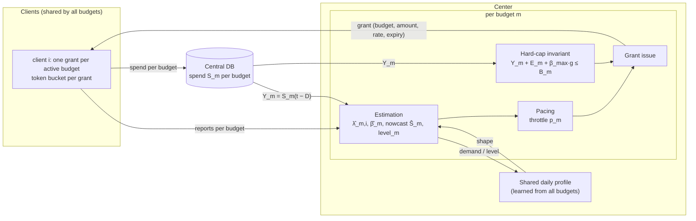
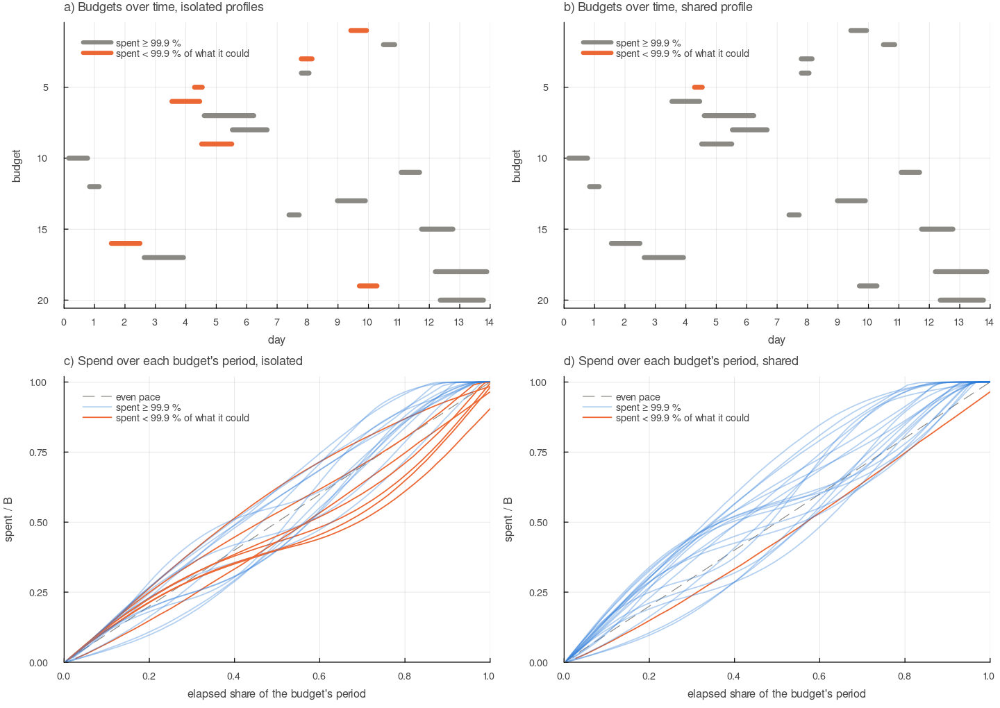

# Many independent budgets on the same clients: model, design, results

## 1. Problem

The single-center problem ([MODEL.md](MODEL.md)) had one budget $B$ over one period $T$. Now one
center runs **many budgets** $m = 1, \ldots, M$:

- Each budget has its **own size** $B_m$, its **own start** $t_m$ and **own end** $t_m + T_m$, and its **own demand rate**. Some budgets have more demand than they need, some less.
- **Every client serves every budget.** A client's traffic drives the demand of all budgets at once, so all budgets share the clients' sizes, daily and weekly patterns, and slow drift.
- Budgets are **independent**: money never moves between them.
- For **each** budget, the goals are those of the single-center problem: never spend more than $B_m$ (a hard cap), and spend as much of it as its demand allows.
- Spend is recorded per budget in the central DB, visible only after a delay $D$, and in DB units that differ from client counts by a ratio $\beta$.

The design problem: run the single-center design for every budget at once, and use what the
budgets have in common to do better than running each alone.

## 2. Notation

Symbols of the single-center model (MODEL.md §2) get an index $m$ for the budget.

| Symbol | Meaning |
|---|---|
| $m$, $M$ | budget index; number of budgets |
| $i$ | client index (50 clients, shared by all budgets) |
| $B_m$ | size of budget $m$: its hard cap |
| $t_m$, $T_m$ | start of budget $m$ (absolute time) and its length; it ends at $t_m + T_m$ |
| $H$ | simulated horizon (14 days), starting Monday 00:00 |
| $r_m$ | demand ratio of budget $m$: its mean demand / $(B_m / T_m)$. Below 1 the budget cannot be spent fully. |
| $S_m(t)$ | true cumulative DB spend of budget $m$ |
| $Y_m(t) = S_m(t - D)$ | what the center sees of it in the DB |
| $\hat S_m$, $E_m$ | nowcast and exposure of budget $m$ (MODEL.md §4.1, §4.2) |
| $\hat\lambda_{m,i}$ | the center's estimate of the demand rate of budget $m$ at client $i$ |
| $d_m(t)$ | total demand rate of budget $m$, as reported by all clients |
| $\text{profile}_b$ | daily demand shape, per 15-minute bin $b$ of the day: one per budget (isolated) or one for all budgets (shared) |
| $\text{level}_m$ | scale of budget $m$'s demand against the profile |
| $\hat\Lambda_m(t, t')$ | forecast demand of budget $m$ from $t$ to $t'$ |
| $\text{achieved}_m$ | what budget $m$ spent of what it could spend (§5) |

## 3. World model (what the simulator generates)

Time step $\Delta t = 1$ min. The horizon $H$ is two weeks starting Monday 00:00, so days 5–6 and
12–13 are weekends. Time is absolute: "10:00" means the same moment for every budget.

**Clients** are drawn once and shared by all budgets (`World` in `src/model.jl`):
- size shares $w_i$: lognormal with spread 0.8, normalized to sum 1 (MODEL.md §3);
- daily phase shifts $\phi_i \sim N(0, 60^2)$ min;
- slow drift $x_i(t)$: an Ornstein–Uhlenbeck process (std 0.15, correlation time 6 h; MODEL.md §3), advanced **once per step for all budgets**.

**Budgets** are drawn per run (`draw_budgets` in `src/budgets.jl`):

| Parameter | Distribution (default) |
|---|---|
| size $B_m$ | log-uniform, $10^4$ – $10^6$ |
| length $T_m$ | log-uniform, 1–10 days (median 3.2 days), whole minutes |
| start $t_m$ | uniform, so that the budget ends within the horizon; any time of day |
| demand ratio $r_m$ | uniform, 0.6–2.0 |

With 20 budgets of these lengths, about 5–6 run at the same time on average.

**Demand.** The demand of budget $m$ at client $i$ in one step is

```math
d_{m,i} = \max\Big(0,\; \mu\,\Delta t + \text{cv}\cdot \mu\sqrt{\Delta t}\,\xi_{m,i}\Big),
\qquad
\mu = \mu_{m,i}(t) = \frac{r_m B_m}{T_m}\cdot \frac{w_i}{\bar P_m}\cdot P(t+\phi_i)\cdot e^{x_i(t)-\sigma_x^2/2}
```

- $P$ is the daily × weekly pattern of MODEL.md §3 (trough at midnight, 30 % lower on weekends), in absolute time.
- $\bar P_m$ is the mean of $P$ over budget $m$'s period, so that the expected total demand of the budget is $r_m B_m$, wherever its period falls.
- $\xi_{m,i} \sim N(0, 1)$ is independent per budget and client, with cv = 0.5 per minute.

Only the first factor depends on the budget. Everything that shapes demand over time (the
pattern, the phases, the drift) is the clients', and so is **common to all budgets**. That is the
structure the shared profile uses (§4.2).

**DB and reports.** As in MODEL.md §3, per budget: each unit a client spends on budget $m$ is
recorded as $\beta(1+\varepsilon)$ in that budget's DB series, visible after $D$ = 30 min. Clients
report their cumulative counted spend and demand per budget, with a 1 min lag.

### 3.1 Why this world model

As in MODEL.md §3.1, the world model is a **test bench**: the simplest generator that contains
every difficulty the center must handle, each with its own switch. On top of the single-center
difficulties, it adds those that come from running many budgets:

| Component | Difficulty it creates | Design element it tests |
|---|---|---|
| budgets start at any time of day | a budget that starts at the daytime peak extrapolates it | shared profile (§6.B) |
| short budgets (down to 6 h) | a budget ends before it has seen a full day, so it never learns its own profile | shared profile (§6.A, §6.B) |
| one daily shape for all budgets, scale per budget | the shape can be learned from other budgets, the scale cannot | shared shape × own level (§4.2) |
| sizes over two orders of magnitude | a small budget spread over 50 clients has tiny grants | grant granularity (§6.C) |
| demand ratio 0.6–2.0 | some budgets cannot be filled, some have plenty of demand | achieved metric, feasibility alert |
| many budgets at once | every client holds a grant per budget | bundling of grant requests (§6.E, §6.F) |
| per-budget noise and DB series | budgets must be paced and capped separately | per-budget invariant (§4.1) |

**It is deliberately unfavourable** for the shared profile, as for the single center: the center
is told nothing about the generator, the first budgets start with no profile at all, and in the
"short budgets" worlds only one or two budgets run at a time on average, so the shared profile has
few teachers.

**It is fast**: a 14-day portfolio of 20 budgets at 1-minute steps takes under 1 s per CPU thread.

**What it ignores** (beyond MODEL.md §3.1):
- **All budgets run on all clients with the same weights.** Real budgets often target a subset of clients, or weight them differently, and would then have different demand shapes.
- **Budgets do not compete for demand.** Each budget has its own demand; one unit of demand is never eligible for several budgets.
- **The set of budgets is known when each starts**, and never changes: no budget is raised, cut, paused or cancelled mid-flight.
- **All budgets share one demand shape.** In reality a budget's own audience may have its own daily pattern.

### 3.2 Alternative world models

**How budgets relate to clients and demand**

| Model | Idea | When it is better |
|---|---|---|
| targeting | each budget runs on a subset of clients, or with its own client weights | budgets aimed at regions, segments or sites; each budget has its own mix of daily shapes |
| competing budgets | one unit of demand is eligible for several budgets, and the center chooses which one pays | ad campaigns that target overlapping audiences; then allocation between budgets matters, not only pacing |
| budget-specific shapes | each budget's demand has its own daily or weekly pattern, partly shared | budgets for audiences in different time zones or with different habits |
| budget-specific shocks | an event changes one budget's demand only | a single campaign that goes viral, or is blocked |

**How budgets arrive**

| Model | Idea | When it is better |
|---|---|---|
| arrival process | budgets arrive at random (Poisson, or by business hours), with no list known in advance | long-running systems with a stream of new budgets |
| changes mid-flight | a budget is raised, cut, paused, resumed or cancelled | real operations; tests that the cap holds when $B_m$ shrinks below what is committed |
| recurring budgets | the same budget renews every day or week | daily caps; the profile can be warm-started from the previous period |

The demand, pattern, client and DB alternatives of MODEL.md §3.2 apply here unchanged.

## 4. System design



Every budget runs the single-center design unchanged (MODEL.md §4) on all clients. The only
thing the budgets share in the center is the **daily demand profile**, and only pacing uses it.

### 4.1 Hard-cap invariant, per budget

Each budget has its own invariant, exactly as in MODEL.md §4.1:

```math
Y_m + E_m + \beta_{max}\, g \le B_m\,(1-\delta)
```

A grant $g$ for budget $m$ is issued only if this holds, and is cut down to fit. $E_m$ counts only
budget $m$'s open grants. Because the budgets never share money, this one invariant per budget is
both **sufficient** (no budget can overspend, whatever the others do) and **necessary** (there is
nothing else to protect a budget). It uses no estimates, so neither the shared profile nor any
other budget can break it.

### 4.2 Estimation

Per budget, as in MODEL.md §4.2: the per-client demand estimates $\hat\lambda_{m,i}$ (EWMA, 30 min),
$\hat\beta_m$ (EWMA, 4 h) and the nowcast $\hat S_m = Y_m + \hat\beta_m [C_m(t) - C_m(t-D)]$.

The **demand forecast** $\hat\Lambda_m$ needs a daily profile. There are two variants.

**Isolated** (`profile = :isolated`): each budget learns its own profile from its own demand, as a
single center does. A budget has no profile until it has seen each 15-minute bin once; until then
it uses its 1-day average demand rate for every future bin. A budget shorter than a day never sees
a full day. The 1-day average starts at the first observed rate, so a budget that starts at the
daytime peak expects the peak to last.

**Shared** (`profile = :shared`, default): the center learns one daily **shape** from all active
budgets, and each budget learns only its own **scale**. This works because the demand of every
budget is its own constant times the same clients' pattern (§3).

- Each budget's scale is its level against the shared shape, an EWMA (4 h) of its demand divided by the shape:

```math
\text{level}_m \leftarrow \text{EWMA}_{4\,\text{h}}\Big(\frac{d_m(t)}{\text{profile}_{b(t)}}\Big)
```

- The shape of bin $b$ is the total demand of all active budgets divided by their total scale, averaged over the bin, and blended into the previous days' value with weight 0.5:

```math
\text{profile}_b \leftarrow 0.5\cdot\text{profile}_b + 0.5\cdot\frac{\sum_m d_m}{\sum_m \text{level}_m}
```

- A new budget sets its level from its first minute of demand in a bin the shape has already seen, and from then on forecasts with the shared shape:

```math
\hat\Lambda_m(t, t') = \sum_{\text{bins } b \text{ from } t \text{ to } t'} \text{level}_m \cdot \text{profile}_b \cdot \Delta t_b
```

- A bin is unseen until some budget has been active through it once. For unseen bins, budgets use their 1-day average rate, as in the isolated variant, and contribute that average as their scale. The first value of a bin is taken as it is; later days are blended in as above.

Only the product level × profile enters the forecast, so the split between shape and scale does
not need to be pinned down. The shape is learned in absolute time, so it is the same for a budget
that starts at 03:00 and one that starts at 15:00. The level also absorbs the weekly effect (the
weekend dip), as the single-center level factor does.

### 4.3 Pacing law

Per budget, as in MODEL.md §4.3, on the budget's own clock: remaining budget
$R_m = B_m(1-\delta) - \hat S_m$, planned end $t_m + T_m - 1$ h (finish buffer), haircut 0.2, and

```math
p_m = \frac{R_m}{\hat\beta_m\,(1-h_c)\,\hat\Lambda_m(t,\ t_m + T_m - \text{buffer})},
\qquad
\text{rate}_{m,i} = \min(p_m,\ 1.5)\cdot\hat\lambda_{m,i}
```

So each budget throttles all clients by the same factor, and spends its money when its demand is
there. With the shared profile, $\hat\Lambda_m$ has the right shape from the budget's first minute.

### 4.4 Grants and client behaviour

As in MODEL.md §4.4, per budget. A client holds **up to one grant per active budget**, each with its
own token bucket, renewal, re-grant and partial return. Two rules are relative to the budget:

| Element | Rule |
|---|---|
| duration | $\tau = \text{clamp}(0.01\,(t_m + T_m - t),\ 5,\ 60)$ min, from the budget's own end; no grant outlives its budget |
| minimum grant | $1 \cdot B_m / 10^6$: grants below it are not issued. With a fixed minimum, small budgets spread over 50 clients lose their small grants (§6.C). |
| bundling | when a client sends a request for one budget, it also renews, in the same message, every other grant it would have to renew within 5 min (`bundle_window`). The center serves all of them in the same minute, each under its own budget's cap. Renewing a few minutes early replaces the old grant, whose unused part is freed at once. Grants of one client then tend to expire together, so their next renewals bundle as well (§6.F). |

### 4.5 Budget lifecycle

- **Before its start** a budget does not exist: no grants, no demand, no estimates.
- **At its start**, every client requests a grant for it. The first grants arrive after the 1 min grant latency, and the estimates start from the first demand reports (1 min lag). With the shared profile, the budget's forecast has the right shape as soon as it has one minute of demand.
- **During its period** it is paced and capped on its own, as a single center.
- **In its last hour** (the finish buffer) it serves all its demand, and its cap stops it at $B_m$.
- **At its end** its grants have all expired, because no grant outlives its budget. Nothing is carried over to other budgets.

### 4.6 Feasibility alert

Per budget, as in MODEL.md §4.5, after the budget's first day: an alert when its forecast remaining
demand cannot fill its remaining budget. Budgets shorter than a day never raise it.

## 5. Simulation setup

`PortfolioConfig` (`src/budgets.jl`) holds the single-center `Config` that every budget shares
(world, assumptions and policy; `B`, `T` and `demand_ratio` are set per budget), plus:

| Parameter | Default | Meaning |
|---|---|---|
| `horizon` | 14 days | simulated time, starting Monday 00:00 |
| `n_budgets` | 20 | number of budgets |
| `B_range` | $10^4$ – $10^6$ | budget size, log-uniform |
| `days_range` | 1–10 days | budget length, log-uniform |
| `ratio_range` | 0.6–2.0 | demand ratio, uniform |
| `budgets` | none | explicit list of (B, start, length, ratio), replacing the random draw |
| `profile` | `:shared` | `:shared` or `:isolated` (§4.2) |
| `scale_min_grant` | true | minimum grant $\propto B_m$ (§4.4) |
| `bundle_window` | 5 min | a request also renews the client's other grants due within this window (0: no bundling; §4.4) |

Each configuration is run with 20 random seeds, i.e. 20 portfolios. Budgets are pooled over all
portfolios. Metrics:

- **achieved** = $S_m(\text{end}) / \min(B_m,\ \text{all demand of } m)$: what a budget spent of what it could spend. 100 % means it spent its whole budget, or, if its demand was smaller, all of its demand;
- **weighted**: achieved, weighted by what each budget could spend;
- **5th percentile**, **worst**, and the **share of budgets at ≥ 99.9 %**;
- **over cap**: budgets that spent more than $B_m$ (must be 0 when the assumptions hold).

## 6. Strategies and results

`out/budgets.md`; 20 portfolios of 20 budgets per cell. No budget exceeded its cap in any cell of
tables A, B, C, E and F.

### A. Isolated vs shared demand profile

_cell: weighted % achieved / 5th percentile % / share of budgets ≥ 99.9 %_

| profile | default: demand 0.6–2×, 1–10 d | demand 1.0–1.2×, 1–10 d | demand 1.0–1.2×, 6 h – 2 d | demand 0.6–0.95× (cannot fill) | 50 budgets, demand 1.0–1.2×, 6 h – 2 d |
|---|---|---|---|---|---|
| isolated | 99.85 / 99.42 / 82 | 99.80 / 99.90 / 95 | 98.69 / 89.10 / 74 | 99.54 / 98.65 / 42 | 98.45 / 88.71 / 71 |
| **shared** | 99.91 / 99.48 / 80 | 99.98 / 100.00 / 98 | 99.81 / 99.56 / 90 | 99.75 / 99.19 / 38 | 99.92 / 99.80 / 91 |

- **With plenty of demand and long budgets** (default), the forecast hardly matters: both reach 99.9 %.
- **Short budgets with tight demand** are where the shared profile matters. Isolated, the worst 5 % of budgets spend less than 89 % of what they could; shared, more than 99.6 %. The share of budgets spent to 99.9 % rises from 74 % to 90 %.
- **More budgets** make the shared profile better (50 budgets: 99.92 %), because more budgets teach it; isolated budgets gain nothing from each other.
- **Budgets that cannot be filled** (demand below $B_m$) serve 99.5–99.8 % of their demand. The rest is lost to per-client pacing: a client never spends faster than 1.5 × its estimated demand, so noisy demand above that is lost.

### B. Which budgets gain (world: demand 1.0–1.2×, 6 h – 2 d)

| budgets | count | isolated | shared |
|---|---|---|---|
| ≤ 12 h | 135 | 99.08 / 89.70 / 66 | 99.76 / 99.24 / 81 |
| 12–24 h | 131 | 97.54 / 84.93 / 66 | 99.78 / 99.09 / 92 |
| 1–2 d | 134 | 99.57 / 98.23 / 90 | 99.89 / 99.98 / 96 |
| starts before any other budget | 20 | 98.93 / 89.14 / 75 | 98.93 / 89.14 / 75 |
| starts after at least one other | 380 | 98.68 / 89.10 / 74 | 99.86 / 99.64 / 91 |
| starts 06–18 h | 210 | 97.76 / 86.15 / 60 | 99.74 / 98.82 / 90 |
| starts 18–06 h | 190 | 99.96 / 99.70 / 89 | 99.90 / 99.70 / 90 |

- **The mechanism is the daytime start.** Isolated budgets that start between 06:00 and 18:00 extrapolate the daytime peak and spend 97.8 %; those that start at night spend 99.96 %. With the shared profile both are at 99.7–99.9 %.
- **12–24 h budgets suffer most**: long enough to run into the night after a daytime start, too short to learn a full day.
- **The first budget gains nothing**: nobody has taught the shape yet. That is the remaining weakness, and a warm start from earlier history would remove it (§8).



_One portfolio, demand 1.0–1.2×, 6 h – 2 d (`scripts/budgets_run.jl`). (a, b) Each bar is one
budget from its start to its end; orange ones spent less than 99.9 % of what they could:
7 of 20 with isolated profiles, 1 with the shared one. (c, d) Spend of each budget over its own
period: isolated budgets fall behind in the second half and do not catch up._

### C. Grant granularity (world: default)

| variant | weighted % | mean % | 5th pct % | worst % | ≥ 99.9 % | grants/min |
|---|---|---|---|---|---|---|
| min grant scales with the budget (default) | 99.91 | 99.89 | 99.48 | 94.29 | 80 % | 22.0 |
| fixed min grant (1 unit for every budget) | 99.62 | 96.92 | 82.39 | 53.93 | 55 % | 15.4 |

A small budget spread over 50 clients has small grants. With a fixed minimum grant, many of them
fall below it and are not issued, and the smallest budgets spend as little as 54 %. The minimum
grant must scale with the budget (or with its rate per client).

### D. Safety assumptions (world: default)

| variant | weighted % | budgets over cap (of 400) | max over (‰ of $B_m$) |
|---|---|---|---|
| assumptions hold (default) | 99.91 | 0 | 0.00 |
| β_true = 1.08 > β_max = 1.06 | 99.92 | 308 | 0.51 |
| D = 30 ± 15 min, D_max = 30 | 99.98 | 288 | 6.62 |

As for a single budget (MODEL.md §6.G): the cap holds exactly as long as the true delay and DB/client
ratio stay within the bounds the center assumes. When they do not, most budgets overspend a little,
because each one runs into its cap at its end.

### E. Number of budgets (world: default)

| variant | weighted % | worst % | grants/min | messages/min |
|---|---|---|---|---|
| 10 budgets | 99.93 | 97.43 | 10.8 | 7.4 |
| 20 budgets | 99.91 | 94.29 | 22.0 | 10.5 |
| 50 budgets | 99.90 | 95.03 | 56.5 | 14.3 |

Quality does not depend on the number of budgets. The grant count grows linearly with it, since
every client holds a grant for every active budget, but with bundling (§4.4, table F) the request
messages grow much more slowly: 5 × the budgets, 2 × the messages.

### F. Bundling grant requests per client

| variant | default (20 budgets): grants/min | messages/min | 50 budgets: grants/min | messages/min |
|---|---|---|---|---|
| no bundling | 20.8 | 20.9 | 51.9 | 52.0 |
| **bundle within 5 min (default)** | 22.0 | 10.5 | 56.5 | 14.3 |
| bundle within 10 min | 25.9 | 9.3 | 71.7 | 13.1 |
| bundle within 30 min | 38.9 | 8.9 | 121.6 | 12.9 |

Spend is the same in every row (99.90–99.92 % weighted), and no budget exceeded its cap.

- **A 5 min window halves the messages** with 20 budgets and cuts them to less than a third with 50, for 6–9 % more grants (renewed a few minutes early).
- **Larger windows do not pay.** They save few further messages but renew grants far too early: with 50 budgets and a 30 min window, 2.3 × the grants.
- **About one message per client every 3–5 min** remains with any window. Grants near a budget's end are short (5–15 min), and re-grants after a demand rise come at any time, so a client keeps sending some messages of its own.

## 7. Recommended policy

1. **One hard-cap invariant per budget**, exactly as for a single budget. Independence makes this both necessary and sufficient.
2. **One shared daily demand shape**, learned from all budgets on the same clients, with a per-budget level. New and short budgets pace with it from their first minute.
3. **Grant granularity relative to the budget**, not a fixed amount.
4. **Bundle a client's grant requests**, renewing in one message every grant due within the next 5 min.
5. Everything else per budget, as in MODEL.md §7: adaptive pacing, finish buffer and haircut, grants shrinking toward the budget's end, re-grant and partial return.

## 8. Limitations and next steps

- **Cold start.** The first budgets still have no shape. A warm start from previous weeks (the shape is a property of the clients, not of a budget) would remove the last gap in table B.
- **Weekly pattern.** The shape is daily; weekends are caught only through each budget's level. A weekly shape, also shared, would help budgets that span a weekend.
- **Budgets with different client mixes.** Here every budget runs on every client with the same weights. If budgets targeted different subsets of clients, each would need the shape of its own subset, or a per-client shape combined by the budget's weights.
- **Competing budgets.** Budgets do not compete for the same demand here: each has its own. If one unit of demand could be paid by several budgets, the center would also have to choose which budget pays.
- **Changes mid-flight** (raising, cutting, pausing a budget) are not modelled. Cutting $B_m$ below $Y_m + E_m$ would need the same care as a transfer in the multi-center design: never below what is committed.
- **Grant traffic** is counted, not limited. Bundling keeps the messages down, but the center still makes one grant decision per budget and client (table F).

## 9. Reproduce

```sh
julia scripts/budgets_run.jl                                 # one portfolio, isolated vs shared → out/budgets_*.csv
julia --project=plots plots/plot_budgets.jl                  # → out/budgets.png
julia -t auto scripts/budgets_mc.jl 20 > out/budgets.md      # tables A–F (~4 min on 10 threads)
```
