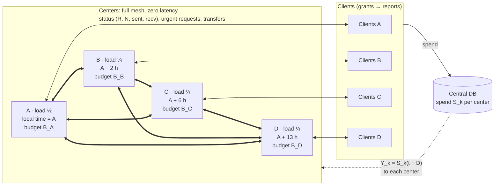
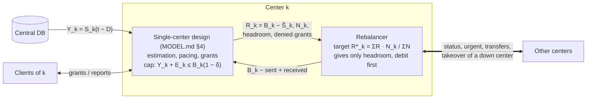
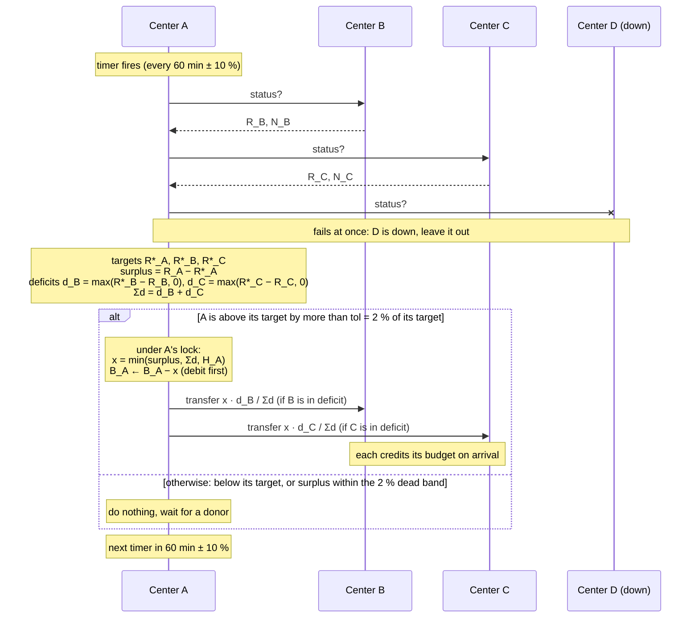
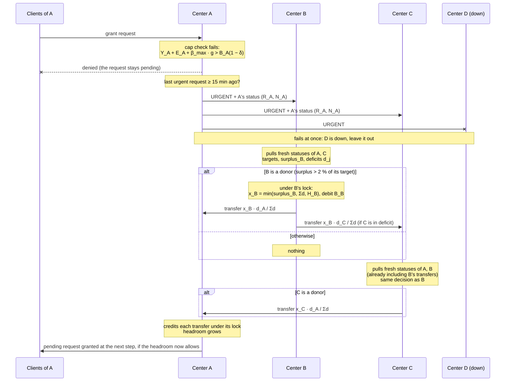
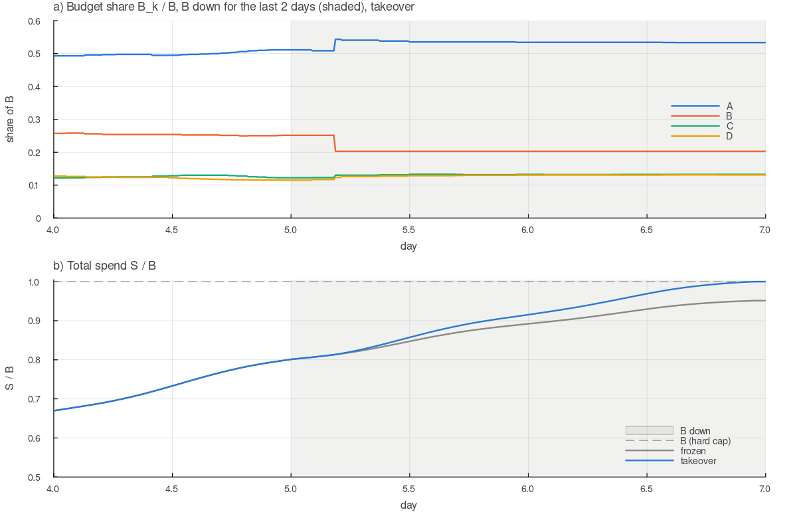

# Several centers sharing one budget: design and results

## 1. Problem

The single-center problem ([MODEL.md](MODEL.md)) now has **four centers**, A, B, C and D. They
share one budget $B$ and one period $T$.

- Each center serves **its own clients** and holds **its own share** $B_k$ of the budget, with $\sum_k B_k = B$.
- **Loads differ** and are not known exactly. The assumed shares are A = 1/2, B = 1/4, C = 1/8, D = 1/8. The true shares may differ, and demand can shift during the period.
- **Local times differ.** B is 2 h behind A, C is 6 h ahead of A, and D is 13 h ahead of A. Daily and weekly demand patterns follow each center's local time.
- All centers read their **own spend** from the single central DB, with delay $D$ as before. Centers can **message each other with zero latency**.
- **A center can be down** for some period. While down it does nothing, but its clients keep spending the grants they already hold.
- **Hard cap:** the total DB spend must never exceed $B$.
- Centers **rebalance** budget from time to time, so that budget sits where the demand is.

| Center | Assumed load | Local time − A | Local time at the start of the period (Mon 00:00 in A) | … at the end |
|---|---|---|---|---|
| A | 1/2 | 0 | Mon 00:00 | Mon 00:00 |
| B | 1/4 | −2 h | Sun 22:00 | Sun 22:00 |
| C | 1/8 | +6 h | Mon 06:00 | Mon 06:00 |
| D | 1/8 | +13 h | Mon 13:00 | Mon 13:00 |

The period is one absolute week. So each center's weekend falls at a different part of it:
D's weekend starts 13 h before A's, and D has 13 h of its Monday left after its weekend ends.

### 1.1 Notation

Amounts are money as the DB records it ("DB units") unless stated. The single-center symbols
are defined in MODEL.md §2; here they get an index $k$ for the center.

**Centers and time**

| Symbol | Meaning |
|---|---|
| $k$, $j$, $i$ | center indices (A, B, C, D). In the rules, $k$ is usually the center that acts (the donor), $j$ another center (a recipient, or the center that is down), $i$ any sender. |
| $t$, $T$ | current time; end of the period (one week) |
| $L$ | center ↔ center message latency (0 by default) |

**Budget and spend of center $k$**

| Symbol | Meaning |
|---|---|
| $B$ | total budget: the hard cap on the total DB spend of all centers |
| $B_k$ | center $k$'s current share of the budget. It changes only through transfers (§2.1) and takeover (§2.5). At the start, $B_k = B \cdot \text{load}_k$. |
| $S_k(t)$ | true cumulative spend of $k$'s clients, as recorded in the DB |
| $D$, $D_{max}$ | DB delay; its upper bound, used for safety |
| $Y_k$ | $k$'s spend as $k$ sees it in the DB: $Y_k(t) = S_k(t - D)$. The only authoritative number, but late. |
| $\hat S_k$ | $k$'s nowcast of $S_k$: $Y_k$ plus the spend its clients reported in the last $D$, converted with $\hat\beta_k$ (MODEL.md §4.2). An estimate. |
| $E_k$ | $k$'s exposure: an upper bound on what its open grants may still add to the DB beyond $Y_k$. It covers spend that has happened but is not in the DB yet, plus the unused amounts of open grants, multiplied by $\beta_{max}$ (MODEL.md §4.1). A bound, not an estimate. |
| $\beta_{max}$, $\hat\beta_k$ | upper bound of the ratio DB amount / client-counted amount; $k$'s estimate of that ratio |
| $\delta$ | extra safety margin, as a fraction of the budget (0 by default) |
| $\tau_{max}$ | longest grant duration (60 min) |

The hard-cap invariant of center $k$ ties these together: $Y_k + E_k \le B_k(1-\delta)$.

**Rebalancing**

| Symbol | Meaning |
|---|---|
| $R_k = B_k - \hat S_k$ | remaining budget: what $k$ has not spent yet (an estimate, because $\hat S_k$ is) |
| $N_k$ | need: $k$'s forecast of the demand it could still spend until $T$ (§2.2) |
| $\hat\Lambda_k(t, T)$, $h$ | $k$'s forecast of its clients' demand from $t$ to $T$ (client units); the forecast haircut (0.2) |
| $R_k^*$ | target: the remaining budget $k$ should have (§2.2). Fair share: the total remaining budget in proportion to need; spend only: $N_k$. |
| tol | rebalancing tolerance, a dead band against tiny transfers: a center gives only when $R_k - R_k^* > \text{tol} \cdot R_k^*$, i.e. when its surplus is more than tol of its own target (tol = 0.02) |
| $d_j = \max(R_j^* - R_j, 0)$ | deficit of center $j$: how far its remaining budget is below its target (0 if at or above it); $\Sigma d$ is the sum over all running centers other than the donor. A donor gives $j$ the share $x \cdot d_j / \Sigma d$ (§2.3). |
| $H_k = B_k - (Y_k + E_k)/(1-\delta)$ | headroom: the most $k$ can give away without breaking its invariant (a bound, §2.1) |
| $x$ | amount of one transfer |
| $F$ | total of transfers in flight (always 0 with zero latency) |
| sent, received | cumulative transfers from $i$ to $j$, as counted by $i$ and by $j$ (§2.4) |

## 2. Design



Each center runs the single-center design unchanged on its own clients and its current $B_k$:
grants, nowcast $\hat S_k$, adaptive pacing, and the hard-cap invariant. Rebalancing is a layer
on top of it, and only changes $B_k$:



The two layers inside a center talk only through $B_k$. The single-center design reports its
remaining budget $R_k$, its need $N_k$ (§2.2) and its headroom, and it signals when it has
denied grants. The rebalancer changes $B_k$ by the transfers it sends and receives. The hard cap
is still enforced by the single-center layer alone.

### 2.1 Hard cap: local invariants plus conserved budget

Each center keeps its own invariant

```math
Y_k + E_k \le B_k\,(1-\delta)
```

and the budget is conserved: $\sum_k B_k + (\text{transfers in flight}) = B$. Together these
give $\sum_k S_k \le \sum_k B_k \le B$ at the end. Two rules keep both properties during transfers.

#### Rule 1: debit first

A transfer of $x$ from donor $k$ to recipient $j$ takes three steps:

1. $k$ lowers its own budget, $B_k \leftarrow B_k - x$;
2. $k$ sends the transfer message;
3. when it arrives, $j$ raises its budget, $B_j \leftarrow B_j + x$.

With zero latency the three steps happen in the same instant. The order still matters when a
transfer fails. If $j$ is down, the send fails at step 2, and $k$ adds $x$ back to its own
budget. Budget is never credited to $j$ before it has left $k$, so it can never be counted twice.

With a latency $L$ (the simulator supports it for sensitivity tests, table C), $x$ belongs to
**no** center while the message travels: neither $k$ nor $j$ can issue grants against it. Let $F$
be the total of transfers in flight. Step 1 moves $x$ from $B_k$ to $F$, and step 3 moves it from
$F$ to $B_j$. So at every moment

```math
\sum_k B_k + F = B
```

and in particular $\sum_k B_k \le B$. Suppose instead the recipient were credited first: $k$
announces that $x$ is now $j$'s, $j$ raises $B_j$ at once, and $k$ debits later. Then for a moment both
centers could issue grants against the same $x$, and their clients could spend it twice. With
debit first, the worst outcome is the opposite one: for a latency, nobody can spend $x$.

*Example* (latency 2 min). A gives 10 to B. At $t$, A's budget goes from 500 to 490 and $F = 10$.
At $t + 1$ min nothing changes. At $t + 2$ min the message arrives: B's budget goes from 250 to 260
and $F = 0$. The sum $B_A + B_B + F$ is 750 throughout.

*Lost messages.* If a transfer were lost, $x$ would leave the system: $\sum_k B_k$ would fall
below $B$. That causes underspend, never overspend. Message loss is not modelled (§6); a real
protocol needs acknowledgements and retries, with an id per transfer so that a retry is never
credited twice.

In the code, `donate!` lowers `s.budget` before it posts the transfer, and `deliver!` raises the
recipient's budget on arrival, or returns the transfer to the sender if the recipient is down.
At the end of every run `simulate_multi` checks that $\sum_k B_k + F = B$.

#### Rule 2: give only headroom

Debit first protects the sum, but a donor must not lower its own $B_k$ below what it has already
committed. Its commitments are exactly what its invariant counts:

- $Y_k$: spend already visible in the DB;
- $E_k$: everything its open grants may still add to the DB beyond $Y_k$. This covers spend that has happened but is not in the DB yet, plus the unused amounts of open grants, all multiplied by $\beta_{max}$ (MODEL.md §4.1).

Clients may spend their grants at any moment until expiry, and the center cannot take a grant
back. So the donor may give away only what is left above its commitments, its **headroom**:

```math
x \le H_k = B_k - \frac{Y_k + E_k}{1-\delta}
```

Its invariant then still holds after the debit:

```math
Y_k + E_k \le (B_k - H_k)(1-\delta) \le (B_k - x)(1-\delta)
```

From then on the single-center argument applies to the new $B_k$. $Y_k + E_k$ does not grow
between grant issues, and each new grant is checked against the lowered budget.

Headroom is not the same as the remaining budget $R_k = B_k - \hat S_k$ that rebalancing
allocates (§2.2). $R_k$ is an estimate of what is not spent yet. $H_k$ is a bound that also
excludes everything open grants may still spend, so usually $H_k < R_k$. The transfer is the
smallest of three amounts:

```math
x = \min(\text{surplus}_k,\ \text{total deficit of the others},\ H_k)
```

*Example* ($\delta = 0$). Center $k$ has $B_k = 100$ and sees $Y_k = 60$ in the DB. Its nowcast
is $\hat S_k = 70$: about 10 has been spent but is not in the DB yet. Its open grants still allow
15 more, so $E_k = 10 + 15 = 25$. Then $R_k = 30$, but $H_k = 100 - 85 = 15$. If $k$ gave away
30, its budget would drop to 70 while its clients may still bring its spend to 85, which is over
the new budget. So $k$ gives at most 15 now. The other 15 is reserved by its open grants. It
becomes headroom again as those grants expire or their unused parts are returned, and the next
time $k$'s timer fires it can move it.

This also means a donor cannot hand over its whole surplus in one step when it has many open
grants. Grants expire within at most 60 min and unused amounts are returned early (MODEL.md §4.4),
so the rest follows on later timers.

In the code, `headroom(site)` computes $H_k$ from `Y` and `E` as they stand after the step's
grants were issued, and `donate!` caps every transfer with it.

No estimate is involved in either rule, as in the single-center cap. In every run below with
the default settings, no center exceeded its own budget and the total never exceeded $B$. The
simulator also checks at the end that budget was conserved.

### 2.2 Allocation target

Each center reports its remaining budget $R_k = B_k - \hat S_k$ and its **need**

```math
N_k = \hat\beta_k\,(1-h)\,\hat\Lambda_k(t, T)
```

(forecast remaining demand in DB units, with the same profile × level forecast and haircut $h$
that its pacing uses). The target splits the total remaining budget of the running centers in
proportion to need:

```math
R_k^* = \Big(\sum_j R_j\Big)\,\frac{N_k}{\sum_j N_j}
```

The ratio $R_k^*/N_k$ is then the same for all centers, so **every center paces at the same
throttle**. This is what a single center serving all clients would do.

**Who gives to whom.** A center gives when its remaining budget is above its target, not when it
spends slowly. Suppose A spends fast and C slowly:

- If C is slow because its **demand is low**, then $N_C$ is small, C's target is small, and C gives to A. *Example* (A and C only): need A 60, C 10; remaining A 50, C 20; the targets are 60 and 10, so C gives 10 to A.
- If C is slow because it is **short of budget** (throttled), A gives to C, even if A could spend its own budget. *Example:* need A 60, C 60; remaining A 50, C 20; the targets are 35 and 35, so A gives 15 to C. Before the transfer A could serve 83 % of its remaining demand and C 33 %; after it, both serve 58 %.

The second kind of transfer does not raise total spend: both centers would have spent their own
budgets anyway. It exists for fairness, so that every center serves the same fraction of its
demand.

**Alternative objective: spend only.** If total spend is the only goal, the target can be each
center's own need instead:

```math
R_k^* = N_k
```

A center then gives only what it cannot spend ($R_k > N_k$), and receives only up to what it can
use ($N_j > R_j$). The second example above moves nothing. This saves transfers, but it is
less fair, and it cannot undo a forecast error: budget that left a center by mistake comes back
only if someone else cannot spend it. Table H compares the two objectives.

### 2.3 Protocol

The centers' clocks are not synchronized, so the protocol never needs two centers to do something
at the same moment. Each center acts on its own timer and on its own events:

- **Periodic, on the center's own timer** (every 60 min ± 10 %, from day 2, with a random phase). When its timer fires, a center **pulls** the current status $(R_j, N_j)$ from every running center. With zero latency the replies are instant, so it has a fresh view of all centers. It computes the targets $R_k^*$ (§2.2). If it is above its target by more than tol = 2 % of that target, it pushes its surplus to the centers in deficit, in proportion to their deficits. If it is below target, it does nothing and waits for a donor.
- **On demand.** A center whose grant requests were denied (it has hit its own cap) sends an *urgent* request to every running center, at most once every 15 min. Each recipient pulls fresh statuses in the same way and decides at once whether to donate.
- **Down centers are left out.** With zero latency a request to a down center fails at once, so every center knows which peers are running. Down centers receive no requests or transfers, and the targets are computed over running centers only. What happens to a down center's own budget is the subject of §2.5.
- **No rebalancing on day 1.** Until then the centers have no demand profile, and their need forecasts are unreliable.

#### What A does when its timer fires



1. **The timer fires.** A's timer runs on A's own clock, every 60 min ± 10 %, from day 2. While A is down, nothing happens; after recovery A first syncs its budget (§2.5) and then acts on its next timer.
2. **Own status.** A takes its own remaining budget $R_A = B_A - \hat S_A$ and its need $N_A$. The single-center design keeps both up to date every minute.
3. **Pull.** A asks every other center for its status: $R_j$, $N_j$, and the sent and received counters. With zero latency the replies arrive at once. A request to a down center fails at once, and that center is left out of everything below.
4. **Targets.** From these numbers A computes the target $R_j^*$ of every running center, its own included (§2.2; fair share by default).
5. **Decide.** A's surplus is $R_A - R_A^\ast$. A is a donor only if the surplus is more than tol × $R_A^\ast$, where tol (`rebalance_tol`, 0.02) is a dead band relative to A's own target. With a target of 200, A gives only when its remaining budget is above 204, and then it gives its whole surplus, not just the part above 204. The dead band keeps small wobbles of the need forecasts from causing transfers back and forth: without it, a week has 419 transfers instead of 171, for almost the same fairness (table C). Otherwise A is not a donor and stops here. A center below its target does not ask anyone for budget on its timer: it waits for a donor, or sends an urgent request when its grants are denied.
6. **Deficits.** For every other running center, $d_j = \max(R_j^* - R_j, 0)$. If all are 0, A stops.
7. **Amount.** Under A's lock, so that no grant is issued in between (§2.6), A computes its headroom $H_A = B_A - (Y_A + E_A)/(1-\delta)$ and the amount $x = \min(\text{surplus},\ \sum_j d_j,\ H_A)$.
8. **Split and send.** Each center in deficit gets $x_j = x \cdot d_j / \sum d$; a share below the minimum transfer (0.01 % of B) is skipped. For each share, A lowers its own budget, $B_A \leftarrow B_A - x_j$, adds $x_j$ to its sent counter, and sends the transfer.
9. **The recipient credits.** On arrival, $j$ raises its own budget, $B_j \leftarrow B_j + x_j$, under its own lock, and adds $x_j$ to its received counter. If $j$ went down in the meantime, the transfer fails and A gets $x_j$ back.
10. **Next timer.** A sets its next timer 60 min ± 10 % later.

A changes only its own budget; each recipient raises its own. A's open grants are not touched.
With a lower $B_A$, A's pacing slows down from its next grants on (MODEL.md §4.3). One timer costs
two messages per running peer for the pull, plus one per transfer.

In the code: the timer is in `simulate_multi`, step 3 is `pull_status!`, and steps 4–8 are
`donate!` (`src/multi.jl`).

#### What happens when A urgently needs more



1. **Trigger.** One of A's clients asks for a grant (a renewal, or a larger grant because its demand rose), and A's cap check fails: A has no headroom left for it. A denies the request. The client keeps its request pending and A retries it every step. This is not a timer: it happens when A hits its own cap, from day 2 on.
2. **Cooldown.** If A sent an urgent request less than 15 min ago, it does nothing more now. The cooldown keeps a center that stays short from flooding the others.
3. **Urgent request.** A sends an urgent request with its current status ($R_A$, $N_A$) to every running center. A request to a down center fails at once, and that center is left out.
4. **Each recipient decides at once,** one after another. It runs steps 2–9 of the timer walkthrough without waiting for its own timer: it pulls fresh statuses from all running centers, computes the targets, and gives if it is a donor (surplus more than 2 % of its target). It gives to *all* centers in deficit, in proportion to their deficits. A is one of them, usually with the largest deficit, but it gets no special priority.
5. **No double fill.** With zero latency, B's transfers arrive before C pulls. So C sees deficits that are already reduced by what B sent, and fills only what is left.
6. **A credits** each transfer under its own lock. Its headroom grows, and at the next step the pending client requests are granted as far as the new headroom allows.
7. **If no one is a donor,** nothing moves. Then A is not short of its fair share: no center is more than 2 % above its target, and A simply has more demand than its share of the budget. A's pacing and its cap keep it within that share, and its clients are served at A's throttle.

**When it happens.** A center that is short of budget mostly lowers its throttle instead of hitting
its cap, so urgent requests are rare in the middle of the period. They come:
- in the last hour, when every center serves all its demand (the finish buffer, MODEL.md §4.3);
- after a sudden local rise in demand;
- right after recovery from a takeover, when the center starts with zero headroom (§2.5).

This is why on-demand rebalancing alone spends the budget, but late and unfairly (§4.A).

In the code: `denied_now` in `step!` (`src/simulate.jl`) triggers it in `simulate_multi`; the
recipient side is `deliver!`, which calls `pull_status!` and `donate!` (`src/multi.jl`).

#### One donor at a time, no synchronized clocks

Only donors move budget. Every donor acts at its own moment, from a view that is fresh at that
moment. That view already includes every transfer that earlier donors have made. So no deficit
is paid twice, and the order in which donors wake up does not matter.

*Example.* Need is split 30/30/15/15 and the remaining budgets are A 30, B 25, C 0, D 5. The total
is 60, so the targets are 20, 20, 10, 10. A's timer fires first, B's 25 min later (spend in
between is ignored here):

| | A | B | C | D |
|---|---|---|---|---|
| remaining $R_k$ | 30 | 25 | 0 | 5 |
| target $R_k^*$ | 20 | 20 | 10 | 10 |
| **A wakes**: surplus 10, deficits C 10, D 5 | sends 6.67 → C, 3.33 → D | | 6.67 | 8.33 |
| **B wakes**: surplus 5, deficits C 3.33, D 1.67 | | sends 3.33 → C, 1.67 → D | 10 | 10 |

A gives its whole surplus, split $10 : 5$ over C and D. When B wakes, it pulls statuses that
already include A's transfers, so it sees the smaller remaining deficits and fills exactly those.
After both have acted, all four centers are on target, through four transfers. The result is the
same as if both had acted at the same instant, and it would be the same if B had woken first.

A donor's view stays incomplete in two cases, and later timers move what is left:
- a donor gives at most its headroom (Rule 2, §2.1);
- surpluses below the tolerance and transfers below the minimum size are skipped.

**Takeover** (§2.5) is a single action too: a down center's unspent budget is split over all
running centers at once, in proportion to their need.

**Clocks.** Everything a center times is a duration on its own clock: its 60 min timer, the 15 min
urgent cooldown, the takeover wait (§2.5). None of these needs synchronized clocks. The end of
the period $T$ must be agreed only to within the clock skew, which is seconds against a simulation
step of a minute.

**Alternatives** (table G):
- *Sync*: all centers report and decide at the same instant. This is the ideal that needs synchronized clocks.
- *Push*: each center broadcasts its own status on its timer, and decides from the statuses it last heard, which may be up to 60 min old. This uses a third of the messages of pull, and works with latency (§2.4).

All three give the same spend, and the served spread and moved budget are within noise. The
statuses change slowly, so a view that is an hour old is still good enough.

### 2.4 Transfers in flight (latency > 0 only)

With zero latency nothing is ever in flight, and this section does not apply. It matters when
the simulator is run with a latency, which needs the *push* mode (table C).

A status reports $R_j$ as it was when it was sent. It does not include transfers that are still on
their way to $j$. Without a correction, the next donor would see the same deficit and pay it
again. To prevent that, every status also carries two cumulative counters:

- **sent** from $i$ to $j$: everything center $i$ has sent to $j$ so far (reported by $i$);
- **received** from $i$ by $j$: everything center $j$ has received from $i$ so far (reported by $j$).

Their difference is what is still on its way from $i$ to $j$. Before a donor computes $j$'s
deficit, it adds what is in flight to $j$ from every sender:

```math
\text{in flight}_{i \to j} = \text{sent}_{i \to j} - \text{received}_{i \to j}
```

```math
R_j^{\text{corrected}} = R_j + \sum_{i \ne j} \text{in flight}_{i \to j}
```

A negative difference can only come from comparing an older status of $i$ with a newer one of
$j$. It counts as zero. For its own transfers, the donor uses its current **sent** counter; for
the others, the counters from their last status. (In the code: `sent[i, j]`, `recv[j, i]`, and
`incoming(j)` in `donate!`.)

Without this correction, budget went back and forth whenever the latency was comparable to the
timer period: 110 % of $B$ moved at latency 30 ± 30 min, against 45 % with it.

### 2.5 Center outages

**What "down" means.** A down center issues no grants and sends or receives no messages. Its
clients keep spending their open grants until those expire, then stop; their demand is not
served until the center comes back. The center keeps its state (grant table, estimates), and
resumes where it stopped.

**The problem.** A down center still holds its share $B_j$. Its unspent part cannot be used by
anyone: the down center issues no grants, and the running centers must not issue grants against
budget that is not theirs. There are two policies.

**Frozen.** The budget waits for the center to come back. This is simple and always safe. If the
center comes back early enough, rebalancing spreads its surplus. If it is still down at $T$, or
comes back too late to spend it, that budget is lost.

**Takeover.** The running centers take over the down center's unspent budget. This is safe only
once the down center can no longer spend anything:

- a down center issues no new grants, so its spend can only come from grants it issued before it went down;
- every grant expires at most $\tau_{max}$ (60 min) after it was issued;
- every spend reaches the DB within $D_{max}$.

So $\tau_{max} + D_{max}$ (about 1.5 h) after the outage starts, the down center's spend is final.
Its DB value $Y_j$, which every center can read, is then exactly what it has spent, and its
exposure is zero. The running centers set

```math
B_j \leftarrow \frac{Y_j}{1-\delta}
```

so that $j$'s invariant still holds with $E_j = 0$. They split the rest,
$B_j - Y_j/(1-\delta)$, among themselves in proportion to their need $N_k$. The total budget does
not change.

Before that time, takeover is not safe: the down center's clients may still be spending their
grants, so its spend can grow beyond the $Y_j$ the others see. Table F shows the result of taking
over after only 10 min: 6 of 40 runs exceed $B$.

**Recovery.** A center that comes back must not issue grants against its old $B_j$. So on
recovery it first asks the running centers for its current budget (instant, with zero latency),
and only then issues grants. After a takeover it starts with $B_j = Y_j$, which means zero
headroom. Its first grant requests are denied, that triggers an urgent request, and the others
give budget back through normal rebalancing. In the simulator, the takeover writes the new $B_j$
directly; this is the value the recovery sync would return.

**Who performs it.** It must be done exactly once, and the centers cannot rely on doing it "at
the same time". So one center is responsible: the running center with the lowest index (A, unless
A is down). It needs no clock: when its own measure of the outage passes the wait, it performs the
takeover and tells the others. It measures the outage from when it noticed it, which is never
before the outage started, so its wait is never too short. As a second guard, every takeover
carries an id, the down center plus the start of its outage, so that a duplicate does nothing
(§2.6).

**When to take over.** Taking over at the earliest safe moment wastes effort when the outage is
short: the budget leaves and has to come back. Waiting is costly near the end, when little time is
left to spend it. The default rule waits in proportion to the time left:

```math
\text{take over once down for at least } \max\big(\tau_{max} + D_{max},\ 0.1\,(T - t)\big)
```

With 4 days left it waits 9.6 h; with 1 day left, 2.4 h; in the last 15 h, only the 1.5 h it
needs for safety.

### 2.6 Concurrency

A donor's action is not atomic: it pulls the statuses, computes the targets, debits itself and
sends the transfers. Another center may do the same at the same moment, and there is no global
lock. This section explains why none is needed for the hard cap, what concurrency can still cost,
and the one place where it must be prevented.

#### Safety needs only local atomicity

Each center is the only writer of its own budget $B_k$; no other center ever changes it. Inside a
center, two operations must be serialized by a local lock:

1. **issuing a grant:** check $Y_k + E_k + \beta_{max}\, g \le B_k(1-\delta)$, then add the grant;
2. **donating:** compute the headroom $H_k$, then debit $B_k$.

Without the lock, a grant could be issued against budget that was just given away. With it, every
center keeps its own invariant whatever the others do at the same moment, and debit first keeps
$\sum_k B_k + F = B$ (§2.1). So the global cap holds with no global lock, no leader and no
synchronized clocks. Concurrency can only make the *allocation* worse, never cause overspend.

#### Under the fair rule, concurrent donors cannot over-fill a deficit

Suppose donors A and B pull at the same moment and see the same snapshot, with surpluses $s_A$,
$s_B$ and deficits $d_j$. Each one sends only its own share of every deficit, so center $j$ gets

```math
\frac{s_A\, d_j}{\sum d} + \frac{s_B\, d_j}{\sum d} = \frac{(s_A + s_B)\, d_j}{\sum d} \le d_j
```

Under the fair rule the targets add up to the total remaining budget, so the total surplus equals
the total deficit and $s_A + s_B \le \sum d$. Two donors acting at the same time give exactly
what they would have given one after the other. If A goes first, every deficit shrinks by the same
factor $1 - s_A/\sum d$, and B then sends $s_B\, d_j/\sum d$ to each center, as it would have
from the old snapshot. This is why the synchronized mode in table G gives the same results as the
unsynchronized ones.

#### Where concurrency does cost something

- **Inconsistent reads.** A center may pull A's status after A has debited a transfer but before the recipient has credited it. It then sees less total budget than there is, and its targets are slightly off. The next timer corrects it.
- **The spend-only rule** (§2.2). Surplus and deficit no longer balance, so concurrent donors can over-fill the same deficit. *Example:* C can use 10 more; A and B each have 20 they cannot spend. Acting at the same moment, each sends 10 to C, so C gets 20. C is now 10 above its need and gives it back on its next timer.

Neither case can cause overspend, and both cost only transfers and messages. In practice they are
rare: a pull, decide and send takes milliseconds, against timers 60 min apart with random phases.

#### Preventing double fills: recipient-side reservation

If double fills must be ruled out, the recipient can serialize them, using only its own lock:

1. The donor asks the recipient: "how much do you need?"
2. Under its own lock, the recipient answers its current deficit $d_j$ minus any amount already reserved, and records the answer as *reserved incoming*.
3. The donor debits itself (debit first) and sends at most the reserved amount.
4. On arrival, the recipient credits the transfer and releases the reservation. A reservation that is not used within a timeout is released too.

A second donor asking at the same moment is told the reduced deficit. This needs no clock and no
leader, and each transfer costs one more request-reply. Heavier alternatives are a token passed
A → B → C → D (only the holder may give) or a single leader that does all rebalancing. Both
serialize everything, but both need extra handling when the token holder or the leader is down.

#### Takeover must not run twice

Takeover is the one operation where concurrency is unsafe. If two centers took over the same down
center, its free budget would be given out twice, and the total of the shares would exceed $B$. Two
guards prevent it:

- **one performer:** only the running center with the lowest index performs takeovers (§2.5);
- **an idempotent id:** each takeover carries the id (down center, start of its outage). Every recipient credits a given id only once, and the recovering center applies it only once. If the responsibility changes hands during an outage (for example, A comes back while B is performing the takeover), a duplicate with the same id does nothing.

In the simulator, two centers never act in exactly the same instant (§6), so none of these
effects are measured yet.

## 3. Simulation setup

`MultiConfig` (`src/multi.jl`) holds a shared `Config` (world, assumptions and policy, with
`base.B` the total budget) plus the following parameters:

| Parameter | Default | Meaning |
|---|---|---|
| `load` | 1/2, 1/4, 1/8, 1/8 | assumed shares, used for the initial split $B_k$ |
| `load_true` | = `load` | true mean demand shares (client counts follow them too: about 50 clients in total) |
| `load_sigma` | 0 | per-run lognormal noise on `load_true` |
| `tz` | 0, −120, +360, +780 min | local time − A's local time |
| `overrides` | none | per-center `Config` changes, e.g. a local demand shock |
| `rebalance` | `:both` | `:none`, `:periodic`, `:on_demand`, `:both` |
| `rebalance_every` | 60 min | each center's rebalancing timer |
| `round_mode` | `:pull` | `:pull` (own timer, pull fresh statuses), `:push` (own timer, last-heard statuses), `:sync` (all at once, ideal) |
| `timer_jitter` | 0.1 | each timer period is `rebalance_every` × (1 ± jitter), with a random phase per center |
| `rebalance_start` | 1 day | no rebalancing before |
| `rebalance_tol` | 0.02 | donor gives only when surplus > tol × its target |
| `objective` | `:fair` | `:fair`: target in proportion to need (equal throttle); `:spend`: target = own need (move only what a center cannot spend) |
| `urgent_cooldown` | 15 min | |
| `net_latency`, `net_jitter` | 0, 0 | center ↔ center message delay (> 0 needs `:push`) |
| `outages` | none | per center: list of (start, length) of outages |
| `outage_mtbf`, `outage_mttr` | ∞, 4 h | random outages: mean time between them and mean length (exponential), per center |
| `takeover` | true | running centers take over a down center's unspent budget (false: frozen) |
| `takeover_after` | $\tau_{max} + D_{max}$ | never take over earlier (safety) |
| `takeover_frac` | 0.1 | and not before the outage has lasted this fraction of the time left |

Total demand is 1.5 × $B/T$ as in the single-center baseline. A center whose demand is still
above its own share can spend that share without any help. So a wrong split hurts only when some
center's true demand falls below its share. In the world "loads 30/30/20/20", A's demand is
$1.5 \cdot 0.3/0.5 = 0.9$ of its share.

Metrics as in MODEL.md, plus the following:
- **Served spread:** max − min over the centers of (spend / demand), in percentage points. With equal pacing, all centers serve the same fraction of their demand.
- **Moved:** gross transfers, as a fraction of B.
- **Net:** how far the budget shares moved from start to end, $\tfrac12\sum_k |B_k^{end}/B - \text{load}_k|$.
- **Taken over:** budget moved from down centers by takeover, as a fraction of B.
- **Stranded:** unspent budget of the centers that are down at $T$, as a fraction of B.

## 4. Results

40 runs per cell (`out/multi.md`), zero latency and the *pull* protocol unless stated.

### A. Rebalancing mode (mean % / min % of B spent)

| mode | loads as assumed | loads 30/30/20/20 | random loads σ=0.3 | D: day-4 shock 20% | A: last-12h 30% | demand ×1.15 |
|---|---|---|---|---|---|---|
| none (static split) | 100.00 / 100.00 | 96.04 / 94.24 | 99.14 / 92.36 | 100.00 / 100.00 | 99.58 / 99.47 | 100.00 / 100.00 |
| periodic (60 min) | 100.00 / 100.00 | 100.00 / 100.00 | 100.00 / 100.00 | 100.00 / 100.00 | 100.00 / 100.00 | 100.00 / 100.00 |
| on demand | 100.00 / 100.00 | 100.00 / 100.00 | 99.99 / 99.54 | 100.00 / 100.00 | 100.00 / 100.00 | 100.00 / 100.00 |
| both | 100.00 / 100.00 | 100.00 / 100.00 | 100.00 / 100.00 | 100.00 / 100.00 | 100.00 / 100.00 | 100.00 / 100.00 |

- A **static split** fails when a center's true demand is below its share: it spends 96 %, and the worst run 92 %. That center serves all of its demand and still leaves budget unused, while the others are throttled. In the 30/30/20/20 world, A serves 100 % of its demand and C and D about 40 % (figure, panel b).
- **Periodic rebalancing** spends 100 % in every world.
- **On demand alone spends the budget, but late and unfairly.** A center that is short of budget does not hit its cap: its pacing just lowers its throttle. So it is denied grants, and calls for help, only near the end of the period. Then the budget moves and is spent, but the short centers were throttled all week: the served spread is 50 pp (table C), against 10 pp with periodic rebalancing. On demand is a good late rescue (the A: last-12h world), not a replacement for the timer.

### B. Cost of rebalancing (mode `both`)

| world | runs over B | centers over own budget | served spread none → both (pp) | transfers | moved % | net % | messages/h |
|---|---|---|---|---|---|---|---|
| loads as assumed | 0 | 0 | 2.4 → 4.2 | 165 | 21.1 | 1.0 | 36.9 |
| loads 30/30/20/20 | 0 | 0 | 59.3 → 9.9 | 171 | 41.5 | 17.8 | 39.1 |
| random loads σ=0.3 | 0 | 0 | 40.1 → 6.2 | 164 | 28.4 | 8.0 | 38.1 |
| D: day-4 shock 20% | 0 | 0 | 9.8 → 5.5 | 195 | 27.0 | 2.3 | 36.9 |
| A: last-12h 30% | 0 | 0 | 3.2 → 4.4 | 194 | 21.8 | 0.8 | 35.4 |
| demand ×1.15 | 0 | 0 | 3.1 → 3.0 | 169 | 22.0 | 0.7 | 35.2 |

- **The hard cap held everywhere.** No run exceeded B, and no center exceeded its own share.
- **Fairness.** When the split is wrong, rebalancing cuts the served spread from 40–60 pp to 6–10 pp. What remains is mostly day 1, which has no rebalancing. Starting at $t = 0$ brings it down to 2.1 pp (table C), but at 2.4 × the transfer volume.
- **Churn.** About 20 % of B moves back and forth even when the split is already right (net 1 %). Two forecast effects cause it. The level factor extrapolates hour-scale demand swings to the end of the period: without it, moved falls from about 22 % to 4 %. And each center's weekend comes at a different absolute time, while no forecast knows about weekends. During D's weekend, D forecasts low demand for the rest of the period and gives budget away. At that time A, still on its Friday, forecasts high demand. As a result, the served spread *grows* slightly when the loads are already right (2.4 → 4.2 pp), and with all time zones set to 0 it is 0.6 pp. Churn costs messages, not spend.
- **Messages.** About 37 per hour in total: each center pulls 3 statuses (request + reply) once an hour, plus urgent requests near the end.

### C. Rebalancing parameters (world: loads 30/30/20/20, mode `both`)

| variant | spend mean % | min % | served spread (pp) | transfers | moved % | net % | messages/h |
|---|---|---|---|---|---|---|---|
| default (pull, every 60 min, tol 0.02) | 100.000 | 100.000 | 9.9 | 171 | 41.5 | 17.8 | 39.1 |
| every 5 min | 100.000 | 100.000 | 9.7 | 244 | 42.9 | 17.8 | 265.4 |
| every 15 min | 100.000 | 100.000 | 9.7 | 223 | 42.7 | 17.8 | 100.8 |
| every 240 min | 100.000 | 100.000 | 10.3 | 97 | 37.9 | 17.7 | 23.6 |
| periodic only, every 240 min | 100.000 | 100.000 | 10.4 | 89 | 37.8 | 17.7 | 5.1 |
| tol 0 | 100.000 | 100.000 | 9.7 | 419 | 48.0 | 17.8 | 39.1 |
| tol 0.05 | 100.000 | 100.000 | 10.2 | 73 | 34.7 | 17.7 | 39.2 |
| tol 0.1 | 100.000 | 100.000 | 11.2 | 32 | 27.4 | 17.6 | 39.3 |
| start at t = 0 | 100.000 | 100.000 | 2.1 | 237 | 100.7 | 19.9 | 43.2 |
| push, latency 30 ± 30 min | 100.000 | 100.000 | 10.7 | 168 | 45.1 | 17.6 | 12.9 |
| push, latency 120 min | 100.000 | 100.000 | 11.8 | 154 | 44.4 | 17.4 | 12.9 |
| on demand only | 100.000 | 100.000 | 50.5 | 14 | 6.0 | 5.5 | 11.2 |

- **The timer period hardly matters.** Every 240 min spends the same as every 5 min and widens the spread by only 0.6 pp, with 1/11 of the messages. Demand shares drift over hours to days, not minutes.
- **Tolerance** trades transfers for fairness. tol 0.1 cuts transfers 5× and widens the spread by 1.3 pp.
- **Latency**, if there were any, would cost nothing in spend up to 2 h with the push protocol, because transfers in flight are accounted for (§2.4).

### D. Late local drop (world: A at 30 % in the last 12 h)

| variant | spend mean % | min % | served spread (pp) | transfers | moved % | messages/h |
|---|---|---|---|---|---|---|
| none | 99.575 | 99.467 | 3.2 | 0 | 0.0 | 0.0 |
| periodic (60 min) | 100.000 | 100.000 | 4.5 | 178 | 21.8 | 20.6 |
| on demand | 100.000 | 100.000 | 2.8 | 35 | 1.2 | 14.8 |
| both | 100.000 | 100.000 | 4.4 | 194 | 21.8 | 35.4 |
| both, haircut 0.05 | 99.998 | 99.982 | 4.4 | 194 | 24.9 | 29.6 |
| both, push, latency 30 min | 100.000 | 100.000 | 4.7 | 189 | 22.5 | 12.4 |

With one center, a late drop of all demand costs 0.9 % of B, and 3.1 % with haircut 0.05
(MODEL.md §6.B). With four centers, only A drops, and the other centers absorb its unspent
budget. Both periodic and on-demand rebalancing recover the full spend, even with haircut 0.05.


_One run, loads 30/30/20/20 (`scripts/multi_run.jl`). (a) Budget shares move to the true loads
once rebalancing starts on day 2. (b) With a static split, A serves all of its demand while C and D serve about 40 %.
(c) With rebalancing, all centers pace alike from day 2; the remaining gap comes from day 1.
(d) Total spend: 94.8 % with a static split, 100 % with rebalancing._

### E. Center outages (mode `both`, loads as assumed)

Mean % / min % of B spent:

| policy | A down 6 h on day 3 | A down the last 12 h | B down the last 2 days | random: MTBF 2 d, MTTR 4 h | random: MTBF 1 d, MTTR 12 h |
|---|---|---|---|---|---|
| frozen (no takeover) | 100.00 / 100.00 | 98.41 / 98.28 | 94.67 / 94.02 | 99.97 / 99.66 | 88.38 / 71.27 |
| takeover once grants settled | 100.00 / 100.00 | 100.00 / 100.00 | 100.00 / 100.00 | 100.00 / 100.00 | 92.81 / 73.91 |
| **takeover, wait 0.1 × time left (default)** | 100.00 / 100.00 | 100.00 / 100.00 | 100.00 / 100.00 | 100.00 / 100.00 | 90.70 / 71.81 |
| takeover, wait 0.3 × time left | 100.00 / 100.00 | 100.00 / 100.00 | 100.00 / 100.00 | 100.00 / 100.00 | 88.95 / 71.43 |

Taken over % of B / served spread (pp) / stranded % of B:

| policy | A down 6 h on day 3 | A down the last 12 h | B down the last 2 days | random: MTBF 2 d, MTTR 4 h | random: MTBF 1 d, MTTR 12 h |
|---|---|---|---|---|---|
| frozen (no takeover) | 0.0 / 4.3 / 0.00 | 0.0 / 4.1 / 1.59 | 0.0 / 12.1 / 5.33 | 0.0 / 8.4 / 0.03 | 0.0 / 22.9 / 6.23 |
| takeover once grants settled | 28.9 / 5.6 / 0.00 | 1.6 / 4.7 / 0.00 | 5.3 / 16.7 / 0.00 | 117.1 / 12.4 / 0.00 | 286.3 / 26.5 / 1.02 |
| **takeover, wait 0.1 × time left (default)** | 0.0 / 4.3 / 0.00 | 1.6 / 4.7 / 0.00 | 5.3 / 16.8 / 0.00 | 16.5 / 8.8 / 0.00 | 135.4 / 25.8 / 1.28 |
| takeover, wait 0.3 × time left | 0.0 / 4.3 / 0.00 | 1.6 / 4.6 / 0.00 | 5.3 / 16.7 / 0.00 | 2.1 / 8.5 / 0.00 | 50.3 / 23.7 / 1.53 |
| _demand of running centers, mean / min % of B_ | 149 / 147 | 150 / 147 | 145 / 143 | 142 / 125 | 105 / 77 |

- **An outage in the middle of the period does not need takeover.** The center comes back with its budget, and rebalancing spreads it. Taking over at the earliest safe moment moves 29 % of B away during a 6 h outage only to bring it back, and widens the spread.
- **An outage at the end needs takeover.** A frozen budget is stranded: 1.6 % of B when A is down for the last 12 h, 5.3 % when B is down for the last 2 days. With takeover, spend is 100 %.
- **Waiting 0.1 × the time left** gets both right. It ignores the 6 h outage on day 3, takes over within 1.5–5 h near the end, and with moderate random outages takes 16 % of B instead of 117 %.
- **Heavy outages** (each center down about a third of the time) cannot reach 100 % with any policy. The demand of the centers that are running is only 105 % of B on average, and 77 % in the worst run. Earlier takeover helps here (92.8 % against 88.4 % frozen), because long outages are common. Some budget is still stranded: when a center goes down shortly before $T$, its grants have not settled by $T$.
- **The served spread grows with takeover** in the "B down" world. That is B's lost demand: B serves nothing for 2 days, while the others now have more budget to serve theirs.



_One run, B down for the last 2 days (`scripts/multi_run.jl`). (a) About 5 h into the outage
(0.1 × the 48 h left), A, C and D take over B's unspent budget. B keeps a share equal to what it
has already spent. (b) Total spend: 95.1 % with a frozen budget, 100 % with takeover._

### F. Safety of takeover (world: random outages, MTBF 1 d, MTTR 12 h)

| variant | spend mean % | runs over B | max over (‰ B) | centers over own budget |
|---|---|---|---|---|
| takeover once grants settled ($\tau_{max} + D_{max}$) | 92.808 | 0 | 0.00 | 0 |
| takeover after 10 min (too early!) | 93.369 | 6 | 1.25 | 57 |

Taken over too early, a down center's clients are still spending their open grants. They spend
budget that has already been given to others, and the hard cap breaks. Waiting
$\tau_{max} + D_{max}$ is what makes takeover safe.

### G. Round mode: no synchronized clocks needed (mode `both`)

Mean % of B spent / served spread (pp) / moved % of B / messages per hour:

| round mode | loads as assumed | loads 30/30/20/20 | random loads σ=0.3 |
|---|---|---|---|
| sync: all at the same instant (ideal) | 100.00 / 4.2 / 22.1 / 13 | 100.00 / 9.7 / 42.2 / 13 | 100.00 / 6.1 / 29.4 / 13 |
| **pull: own timer, pull fresh statuses (default)** | 100.00 / 4.2 / 21.1 / 37 | 100.00 / 9.9 / 41.5 / 39 | 100.00 / 6.2 / 28.4 / 38 |
| push: own timer, last-heard statuses | 100.00 / 4.3 / 21.2 / 13 | 100.00 / 10.1 / 43.5 / 13 | 100.00 / 6.3 / 29.6 / 13 |

Centers that act on their own unsynchronized timers do as well as the ideal synchronized round.
*Pull* gives every donor a fresh view and costs about 3 × the messages of *push*, still under
40 per hour. *Push* is as good in these worlds, because statuses change slowly. It is the choice
when messages have latency.

### H. Objective: fair share vs spend only (mode `both`)

| world | objective | spend mean % | min % | served spread (pp) | transfers | moved % | net % |
|---|---|---|---|---|---|---|---|
| loads as assumed | fair | 100.000 | 100.000 | 4.2 | 165 | 21.1 | 1.0 |
| loads as assumed | spend | 100.000 | 100.000 | 2.4 | 0 | 0.0 | 0.0 |
| loads 30/30/20/20 | fair | 100.000 | 100.000 | 9.9 | 171 | 41.5 | 17.8 |
| loads 30/30/20/20 | spend | 100.000 | 100.000 | 36.8 | 16 | 9.9 | 9.9 |
| random loads σ=0.3 | fair | 100.000 | 100.000 | 6.2 | 164 | 28.4 | 8.0 |
| random loads σ=0.3 | spend | 100.000 | 100.000 | 29.4 | 15 | 2.4 | 2.4 |
| D: day-4 shock 20% | fair | 100.000 | 100.000 | 5.5 | 195 | 27.0 | 2.3 |
| D: day-4 shock 20% | spend | 100.000 | 100.000 | 23.9 | 53 | 4.8 | 4.8 |
| A: last-12h 30% | fair | 100.000 | 100.000 | 4.4 | 194 | 21.8 | 0.8 |
| A: last-12h 30% | spend | 99.986 | 99.977 | 2.9 | 25 | 0.4 | 0.4 |
| demand ×1.15 | fair | 100.000 | 100.000 | 3.0 | 169 | 22.0 | 0.7 |
| demand ×1.15 | spend | 100.000 | 100.000 | 4.3 | 40 | 2.1 | 0.7 |
| loads 30/30/20/20, demand ×1.15 | fair | 100.000 | 100.000 | 8.2 | 172 | 43.6 | 18.8 |
| loads 30/30/20/20, demand ×1.15 | spend | 100.000 | 100.000 | 10.3 | 68 | 22.9 | 18.5 |
| B down the last 2 days | fair | 100.000 | 100.000 | 16.8 | 145 | 20.7 | 4.6 |
| B down the last 2 days | spend | 100.000 | 100.000 | 17.6 | 10 | 0.8 | 4.9 |

No run exceeded B with either objective.

- **Total spend is the same.** Both objectives spend 100 % everywhere, except the late local drop, where spend only reaches 99.986 %. So the fair-share transfers are not needed for spend: they only buy fairness.
- **Spend only makes far fewer transfers:** none at all when the loads are as assumed, and 10–70 per week elsewhere instead of 145–195. When the loads are as assumed it is also *fairer*, 2.4 pp against 4.2, because none of the forecast-driven churn of §4.B happens.
- **When the split is wrong, spend only is unfair.** In the 30/30/20/20 world, A gives only the budget it cannot spend. B, C and D get just enough to spend their budgets, not enough to serve the same fraction of their demand as A: the spread is 37 pp, against 10 pp.
- **Spend only cannot undo a forecast error.** During D's day-4 drop, D's forecast assumes the low demand lasts to the end of the period, so D gives budget away. When its demand comes back, nobody gives it back, because everyone else can spend what they hold. The spread ends at 24 pp, worse than a static split (10 pp, table B). The fair rule rebalances again as soon as D's need rises.
- **When demand is close to the budget** (×1.15), the two rules come closer: most transfers are needed for spend anyway.

A middle way is the fair rule with a larger tolerance: tol 0.1 cuts transfers to 32 per week with
a spread of 11 pp in the 30/30/20/20 world (table C), far fairer than spend only at a similar
number of transfers.

## 5. Recommended policy

1. **Local invariant + debit-first transfers, limited to headroom**, with grant issue and donation serialized by a local lock inside each center. This keeps the global cap with no global lock, no estimates and no synchronized clocks (§2.6).
2. **Each center on its own timer**, every 1–4 h: pull the current statuses, allocate remaining budget in proportion to forecast need (fair share), and push surplus if above target. Only donors act. If transfers are costly, raise the tolerance rather than switch to spend only.
3. **On-demand requests** when a center is denied grants, as a fast path at the end of the period and after local demand drops.
4. **Takeover of a down center's unspent budget** by the lowest-index running center, with an idempotent takeover id, never before $\tau_{max} + D_{max}$ and otherwise after 0.1 × the time left; a recovering center syncs its budget before it issues grants.
5. **Cumulative sent/recv counters in every status**, in case messages ever have latency, so that transfers in flight are not paid twice.
6. **Initial split by assumed load**, with no rebalancing until the profiles are learned (or warm-start them).

## 6. Limitations and next steps

- **Forecasts know nothing about weekly patterns.** With time zones this causes churn and some unfairness (§4.B). A weekly profile warm-started from previous periods would remove most of it.
- **Only crashes are modelled, not partitions.** A center that is running but cannot reach its peers would keep issuing grants on its own budget, and taking that budget over would break the cap. Telling the two apart needs a fence, for example a lease: a center may issue grants only while it holds a lease that its peers renew.
- **Concurrent actions are not modelled.** In the simulator, two centers never act in exactly the same instant. §2.6 explains why this does not matter for the hard cap, what it can cost, and how to prevent double fills and double takeovers. Modelling it (donors whose timers fire close together acting on the same stale snapshot) would measure the cost.
- **Message loss is not modelled.** With debit first, a lost transfer is lost budget: safe, but it causes underspend. A real protocol needs acknowledgements and retries with idempotent transfer ids, or a reconciliation through the DB.
- **The DB is assumed to report per-center spend.** If it reported only the total, the centers would have to exchange exposure, and the local-invariant argument would no longer work. Takeover also relies on every center being able to read a down center's spend.
- **No pooled baseline.** A single center serving all the clients in all time zones would be the upper bound for fairness. The "every 5 min" row is used instead.
- **The number of transfers** could be cut: a donor could fill whole deficits one at a time, largest first, instead of splitting its surplus over all of them.

## 7. Reproduce

```sh
julia scripts/multi_run.jl                                   # example runs → out/multi_run_*.csv, out/multi_outage_*.csv
julia --project=plots plots/plot_multi.jl                    # → out/multi.png, out/multi_outage.png
julia -t auto scripts/multi_strategies.jl 40 > out/multi.md  # tables A–H (~2.5 min on 10 threads)
```
