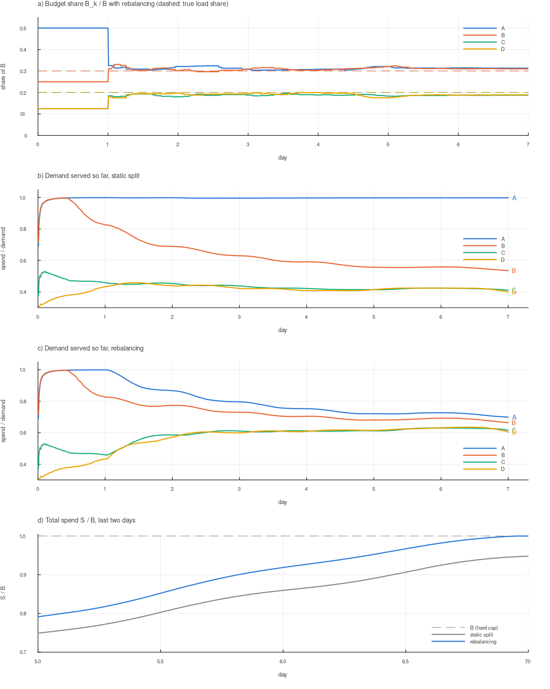

# Several centers sharing one budget: design and results

## 1. Problem

The single-center problem ([MODEL.md](MODEL.md)) now has **four centers**, A, B, C and D. They
share one budget $B$ and one period $T$.

- Each center serves **its own clients** and holds **its own share** $B_k$ of the budget, with $\sum_k B_k = B$.
- **Loads differ** and are not known exactly. The assumed shares are A = 1/2, B = 1/4, C = 1/8, D = 1/8. The true shares may differ, and demand can shift during the period.
- **Local times differ.** B is 2 h behind A, C is 6 h ahead of A, and D is 13 h ahead of A. Daily and weekly demand patterns follow each center's local time.
- All centers read their **own spend** from the single central DB, with delay $D$ as before. Centers can **message each other**, with a latency.
- **Hard cap:** the total DB spend must never exceed $B$.
- Centers **rebalance** budget from time to time, so that budget sits where the demand is.

| Center | Assumed load | Local time − A | Local time at the start of the period (Mon 00:00 in A) | … at the end |
|---|---|---|---|---|
| A | 1/2 | 0 | Mon 00:00 | Mon 00:00 |
| B | 1/4 | −2 h | Sun 22:00 | Sun 22:00 |
| C | 1/8 | +6 h | Mon 06:00 | Mon 06:00 |
| D | 1/8 | +13 h | Mon 13:00 | Mon 13:00 |

The period is one absolute week. So each center's weekend falls at a different part of it:
D's weekend starts 13 h before A's, and D has 13 h of its Monday left after its weekend ends.

## 2. Design

Each center runs the single-center design unchanged on its own clients and its current $B_k$:
grants, nowcast $\hat S_k$, adaptive pacing, and the hard-cap invariant. Rebalancing is a layer
on top of it, and only changes $B_k$.

### 2.1 Hard cap: local invariants plus conserved budget

Each center keeps its own invariant

```math
Y_k + E_k \le B_k\,(1-\delta)
```

and the budget is conserved: $\sum_k B_k + (\text{transfers in flight}) = B$. Together these
give $\sum_k S_k \le \sum_k B_k \le B$ at the end. Two rules keep both properties during transfers:

1. **Debit first.** The donor lowers its own $B_k$ *before* it sends the transfer, and the recipient raises its $B_j$ only when the transfer arrives. Budget in flight belongs to no one, so it can never be counted twice.
2. **Give only headroom.** A donor gives at most $B_k - (Y_k + E_k)/(1-\delta)$, so its own invariant still holds after the debit. Budget reserved by its open grants never leaves.

No estimate is involved, as in the single-center cap. In every run below, no center exceeded its
own budget and the total never exceeded $B$. The simulator also checks at the end that budget was conserved.

### 2.2 Allocation target

Each center reports its remaining budget $R_k = B_k - \hat S_k$ and its **need**

```math
N_k = \hat\beta_k\,(1-h)\,\hat\Lambda_k(t, T)
```

(forecast remaining demand in DB units, with the same profile × level forecast and haircut $h$
that its pacing uses). The target splits the total remaining budget in proportion to need:

```math
R_k^* = \Big(\sum_j R_j\Big)\,\frac{N_k}{\sum_j N_j}
```

The ratio $R_k^*/N_k$ is then the same for all centers, so **every center paces at the same
throttle**. This is what a single center serving all clients would do.

### 2.3 Protocol

- **Periodic round** (every 60 min, from day 2). Every center broadcasts a status $(R_k, N_k, \text{sent}_k, \text{recv}_k)$. Once the round's statuses have arrived (latency + jitter), every center computes the targets from the same snapshot. **Only donors act**: a center with $R_k - R_k^* > \text{tol}\cdot R_k^*$ (tol = 2 %) pushes its surplus to the centers in deficit, in proportion to their deficits. All donors use the same snapshot, so together they fill each deficit once.
- **On demand.** A center whose grant requests were denied (it has hit its own cap) sends an *urgent* status, at most once every 15 min. Each recipient decides at once whether to donate.
- **Transfers in flight.** A status reports $R_j$ as it was when it was sent. It does not include transfers that are still on their way to $j$. Without a correction, the next round would see the same deficit and pay it again. To prevent that, every status also carries two cumulative counters:
  - `sent[i, j]`: everything center $i$ has sent to $j$ so far;
  - `recv[j, i]`: everything center $j$ has received from $i$ so far.

  The difference is what is still in flight from $i$ to $j$. A donor adds it, summed over all senders $i$, to the reported $R_j$ before it computes $j$'s deficit:

  ```math
  R_j^{\text{used}} = R_j^{\text{reported}} + \sum_{i \ne j} \max\big(\text{sent}[i, j] - \text{recv}[j, i],\; 0\big)
  ```

  For its own transfers, the donor uses its current `sent` counter. For the others, it uses the counters from their last status. Without this correction, budget went back and forth whenever latency was comparable to the round period: 110 % of $B$ moved at latency 30 ± 30 min, against 45 % with it.
- **No rebalancing on day 1.** Until then the centers have no demand profile, and their need forecasts are unreliable.

## 3. Simulation setup

`MultiConfig` (`src/multi.jl`) holds a shared `Config` (world, assumptions and policy, with
`base.B` the total budget) plus the following parameters:

| Parameter | Default | Meaning |
|---|---|---|
| `load` | 1/2, 1/4, 1/8, 1/8 | assumed shares, used for the initial split $B_k$ |
| `load_true` | = `load` | true mean demand shares (client counts follow them too: about 50 clients in total) |
| `load_sigma` | 0 | per-run lognormal noise on `load_true` |
| `tz` | 0, −120, +360, +780 min | local time − A's local time |
| `overrides` | none | per-center `Config` changes, e.g. a local demand shock |
| `rebalance` | `:both` | `:none`, `:periodic`, `:on_demand`, `:both` |
| `rebalance_every` | 60 min | periodic round |
| `rebalance_start` | 1 day | no rebalancing before |
| `rebalance_tol` | 0.02 | donor gives only when surplus > tol × its target |
| `urgent_cooldown` | 15 min | |
| `net_latency`, `net_jitter` | 2 min, 0 | center ↔ center message delay |

Total demand is 1.5 × $B/T$ as in the single-center baseline. A center whose demand is still
above its own share can spend that share without any help. So a wrong split hurts only when some
center's true demand falls below its share. In the world "loads 30/30/20/20", A's demand is
$1.5 \cdot 0.3/0.5 = 0.9$ of its share.

Metrics as in MODEL.md, plus the following:
- **Served spread:** max − min over the centers of (spend / demand), in percentage points. With equal pacing, all centers serve the same fraction of their demand.
- **Moved:** gross transfers, as a fraction of B.
- **Net:** how far the budget shares moved from start to end, $\tfrac12\sum_k |B_k^{end}/B - \text{load}_k|$.

## 4. Results

40 runs per cell (`out/multi.md`).

### A. Rebalancing mode (mean % / min % of B spent)

| mode | loads as assumed | loads 30/30/20/20 | random loads σ=0.3 | D: day-4 shock 20% | A: last-12h 30% | demand ×1.15 |
|---|---|---|---|---|---|---|
| none (static split) | 100.00 / 100.00 | 96.04 / 94.24 | 99.14 / 92.36 | 100.00 / 100.00 | 99.58 / 99.47 | 100.00 / 100.00 |
| periodic (60 min) | 100.00 / 100.00 | 100.00 / 100.00 | 100.00 / 100.00 | 100.00 / 100.00 | 100.00 / 100.00 | 100.00 / 100.00 |
| on demand | 100.00 / 100.00 | 99.89 / 98.54 | 99.92 / 96.62 | 100.00 / 100.00 | 100.00 / 100.00 | 100.00 / 100.00 |
| both | 100.00 / 100.00 | 100.00 / 100.00 | 100.00 / 100.00 | 100.00 / 100.00 | 100.00 / 100.00 | 100.00 / 100.00 |

- A **static split** fails when a center's true demand is below its share: it spends 96 %, and the worst run 92 %. That center serves all of its demand and still leaves budget unused, while the others are throttled. In the 30/30/20/20 world, A serves 100 % of its demand and C and D about 40 % (figure, panel b).
- **Periodic rebalancing** spends 100 % in every world.
- **On demand alone is not enough.** A center that is short of budget does not hit its cap: its pacing just lowers its throttle. So it is denied grants, and calls for help, only near the end of the period. On demand works as a late rescue (the A: last-12h world), but it cannot fix a wrong split.

### B. Cost of rebalancing (mode `both`)

| world | runs over B | centers over own budget | served spread none → both (pp) | transfers | moved % | net % | messages/h |
|---|---|---|---|---|---|---|---|
| loads as assumed | 0 | 0 | 2.4 → 4.2 | 166 | 22.3 | 1.0 | 12.7 |
| loads 30/30/20/20 | 0 | 0 | 59.3 → 9.7 | 172 | 42.5 | 17.8 | 13.0 |
| random loads σ=0.3 | 0 | 0 | 40.1 → 6.1 | 166 | 29.5 | 8.0 | 12.9 |
| D: day-4 shock 20% | 0 | 0 | 9.8 → 5.6 | 195 | 28.3 | 2.3 | 12.7 |
| A: last-12h 30% | 0 | 0 | 3.2 → 4.5 | 193 | 23.1 | 0.8 | 12.5 |
| demand ×1.15 | 0 | 0 | 3.1 → 3.0 | 170 | 23.3 | 0.7 | 12.5 |

- **The hard cap held everywhere.** No run exceeded B, and no center exceeded its own share.
- **Fairness.** When the split is wrong, rebalancing cuts the served spread from 40–60 pp to 6–10 pp. What remains is mostly day 1, which has no rebalancing. Starting at $t = 0$ brings it down to 2.3 pp (table C), but at 2.6 × the transfer volume.
- **Churn.** About 20 % of B moves back and forth even when the split is already right (net 1 %). Two forecast effects cause it. The level factor extrapolates hour-scale demand swings to the end of the period: without it, moved falls from 23 % to 4 %. And each center's weekend comes at a different absolute time, while no forecast knows about weekends. During D's weekend, D forecasts low demand for the rest of the period and gives budget away. At that time A, still on its Friday, forecasts high demand. As a result, the served spread *grows* slightly when the loads are already right (2.4 → 4.2 pp), and with all time zones set to 0 it is 0.6 pp. Churn costs messages, not spend.

### C. Rebalancing parameters (world: loads 30/30/20/20, mode `both`)

| variant | spend mean % | min % | served spread (pp) | transfers | moved % | net % | messages/h |
|---|---|---|---|---|---|---|---|
| default (every 60 min, tol 0.02, latency 2 min) | 100.000 | 100.000 | 9.7 | 172 | 42.5 | 17.8 | 13.0 |
| every 15 min | 100.000 | 100.000 | 9.7 | 225 | 43.0 | 17.8 | 43.9 |
| every 240 min | 100.000 | 100.000 | 9.7 | 90 | 38.1 | 17.8 | 5.3 |
| periodic only, every 240 min | 100.000 | 100.000 | 9.7 | 87 | 38.1 | 17.8 | 2.6 |
| tol 0 | 100.000 | 100.000 | 9.6 | 390 | 48.9 | 17.9 | 13.0 |
| tol 0.05 | 100.000 | 100.000 | 10.2 | 74 | 35.3 | 17.8 | 13.0 |
| tol 0.1 | 100.000 | 100.000 | 11.0 | 32 | 27.4 | 17.7 | 13.0 |
| start at t = 0 | 100.000 | 100.000 | 2.3 | 236 | 109.7 | 19.8 | 14.7 |
| latency 30 ± 30 min | 100.000 | 100.000 | 10.5 | 192 | 44.8 | 17.7 | 13.0 |
| latency 120 min | 100.000 | 100.000 | 11.4 | 177 | 45.7 | 17.5 | 12.9 |
| near-ideal: every 5 min, latency 1 min | 100.000 | 100.000 | 9.7 | 244 | 42.9 | 17.8 | 126.1 |
| on demand only | 99.886 | 98.541 | 55.2 | 14 | 7.4 | 4.6 | 1.1 |

- **The round period hardly matters.** Every 240 min is as good as every 5 min, with 1/24 of the messages. Demand shares drift over hours to days, not minutes.
- **Tolerance** trades transfers for fairness. tol 0.1 cuts transfers 5× and widens the spread by 1.3 pp.
- **Latency** up to 2 h costs nothing in spend, because transfers in flight are accounted for.

### D. Late local drop (world: A at 30 % in the last 12 h)

| variant | spend mean % | min % | served spread (pp) | transfers | moved % | messages/h |
|---|---|---|---|---|---|---|
| none | 99.575 | 99.467 | 3.2 | 0 | 0.0 | 0.0 |
| periodic (60 min) | 100.000 | 100.000 | 4.5 | 181 | 23.0 | 10.4 |
| on demand | 100.000 | 99.999 | 3.7 | 19 | 1.1 | 2.0 |
| both | 100.000 | 100.000 | 4.5 | 193 | 23.1 | 12.5 |
| both, haircut 0.05 | 99.998 | 99.988 | 4.4 | 198 | 26.2 | 11.6 |
| both, latency 30 min | 100.000 | 100.000 | 4.7 | 194 | 22.8 | 12.5 |

With one center, a late drop of all demand costs 0.9 % of B, and 3.1 % with haircut 0.05
(MODEL.md §6.B). With four centers, only A drops, and the other centers absorb its unspent
budget. Both periodic and on-demand rebalancing recover the full spend, even with haircut 0.05.



_One run, loads 30/30/20/20 (`scripts/multi_run.jl`). (a) Budget shares move to the true loads
once rebalancing starts on day 2. (b) With a static split, A serves all of its demand while C and D serve about 40 %.
(c) With rebalancing, all centers pace alike from day 2; the remaining gap comes from day 1.
(d) Total spend: 94.8 % with a static split, 100 % with rebalancing._

## 5. Recommended policy

1. **Local invariant + debit-first transfers, limited to headroom.** This keeps the global cap with no global coordination and no estimates.
2. **Periodic rounds**, every 1–4 h: allocate remaining budget in proportion to forecast need, and let only donors push.
3. **On-demand requests** when a center is denied grants, as a fast path at the end of the period and after local demand drops.
4. **Cumulative sent/recv counters in every status**, so that transfers in flight are not paid twice.
5. **Initial split by assumed load**, with no rebalancing until the profiles are learned (or warm-start them).

## 6. Limitations and next steps

- **Forecasts know nothing about weekly patterns.** With time zones this causes churn and some unfairness (§4.B). A weekly profile warm-started from previous periods would remove most of it.
- **Message loss and partitions are not modelled.** With debit-first, a lost transfer is lost budget: safe, but it causes underspend. A real protocol needs acknowledgements and retries with idempotent transfer ids, or a reconciliation through the DB.
- **The DB is assumed to report per-center spend.** If it reported only the total, the centers would have to exchange exposure, and the local-invariant argument would no longer work.
- **No pooled baseline.** A single center serving all the clients in all time zones would be the upper bound for fairness. The "near-ideal" row (every 5 min, latency 1 min) is used instead.
- **Gross transfers** could be cut further by netting: one transfer per pair per round, instead of each donor pushing separately.

## 7. Reproduce

```sh
julia scripts/multi_run.jl                                   # one world, static split vs rebalancing → out/multi_run_*.csv
julia --project=plots plots/plot_multi.jl                    # → out/multi.png
julia -t auto scripts/multi_strategies.jl 40 > out/multi.md  # tables A–D (~1 min on 10 threads)
```
