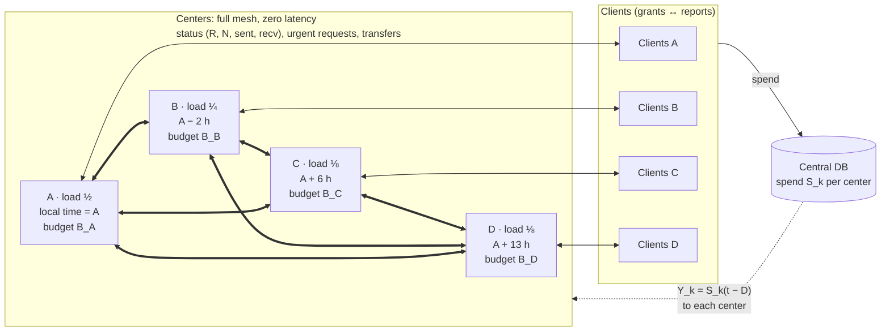
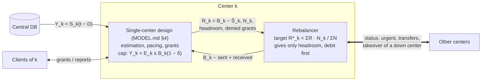

# Several centers sharing one budget: design and results

## 1. Problem

The single-center problem ([MODEL.md](MODEL.md)) now has **four centers**, A, B, C and D. They
share one budget $B$ and one period $T$.

- Each center serves **its own clients** and holds **its own share** $B_k$ of the budget, with $\sum_k B_k = B$.
- **Loads differ** and are not known exactly. The assumed shares are A = 1/2, B = 1/4, C = 1/8, D = 1/8. The true shares may differ, and demand can shift during the period.
- **Local times differ.** B is 2 h behind A, C is 6 h ahead of A, and D is 13 h ahead of A. Daily and weekly demand patterns follow each center's local time.
- All centers read their **own spend** from the single central DB, with delay $D$ as before. Centers can **message each other with zero latency**.
- **A center can be down** for some period. While down it does nothing, but its clients keep spending the grants they already hold.
- **Hard cap:** the total DB spend must never exceed $B$.
- Centers **rebalance** budget from time to time, so that budget sits where the demand is.

| Center | Assumed load | Local time − A | Local time at the start of the period (Mon 00:00 in A) | … at the end |
|---|---|---|---|---|
| A | 1/2 | 0 | Mon 00:00 | Mon 00:00 |
| B | 1/4 | −2 h | Sun 22:00 | Sun 22:00 |
| C | 1/8 | +6 h | Mon 06:00 | Mon 06:00 |
| D | 1/8 | +13 h | Mon 13:00 | Mon 13:00 |

The period is one absolute week. So each center's weekend falls at a different part of it:
D's weekend starts 13 h before A's, and D has 13 h of its Monday left after its weekend ends.

## 2. Design



Each center runs the single-center design unchanged on its own clients and its current $B_k$:
grants, nowcast $\hat S_k$, adaptive pacing, and the hard-cap invariant. Rebalancing is a layer
on top of it, and only changes $B_k$:



The two layers inside a center talk only through $B_k$. The single-center design reports its
remaining budget $R_k$, its need $N_k$ (§2.2) and its headroom, and it signals when it has
denied grants. The rebalancer changes $B_k$ by the transfers it sends and receives. The hard cap
is still enforced by the single-center layer alone.

### 2.1 Hard cap: local invariants plus conserved budget

Each center keeps its own invariant

```math
Y_k + E_k \le B_k\,(1-\delta)
```

and the budget is conserved: $\sum_k B_k + (\text{transfers in flight}) = B$. Together these
give $\sum_k S_k \le \sum_k B_k \le B$ at the end. Two rules keep both properties during transfers.

#### Rule 1: debit first

A transfer of $x$ from donor $k$ to recipient $j$ takes three steps:

1. $k$ lowers its own budget, $B_k \leftarrow B_k - x$;
2. $k$ sends the transfer message;
3. when it arrives, $j$ raises its budget, $B_j \leftarrow B_j + x$.

With zero latency the three steps happen in the same instant. The order still matters when a
transfer fails. If $j$ is down, the send fails at step 2, and $k$ adds $x$ back to its own
budget. Budget is never credited to $j$ before it has left $k$, so it can never be counted twice.

With a latency $L$ (the simulator supports it for sensitivity tests, table C), $x$ belongs to
**no** center while the message travels: neither $k$ nor $j$ can issue grants against it. Let $F$
be the total of transfers in flight. Step 1 moves $x$ from $B_k$ to $F$, and step 3 moves it from
$F$ to $B_j$. So at every moment

```math
\sum_k B_k + F = B
```

and in particular $\sum_k B_k \le B$. Suppose instead the recipient were credited first: $k$
announces "$x$ is yours", $j$ raises $B_j$ at once, and $k$ debits later. Then for a moment both
centers could issue grants against the same $x$, and their clients could spend it twice. With
debit first, the worst outcome is the opposite one: for a latency, nobody can spend $x$.

*Example* (latency 2 min). A gives 10 to B. At $t$, A's budget goes from 500 to 490 and $F = 10$.
At $t + 1$ min nothing changes. At $t + 2$ min the message arrives: B's budget goes from 250 to 260
and $F = 0$. The sum $B_A + B_B + F$ is 750 throughout.

*Lost messages.* If a transfer were lost, $x$ would leave the system: $\sum_k B_k$ would fall
below $B$. That causes underspend, never overspend. Message loss is not modelled (§6); a real
protocol needs acknowledgements and retries, with an id per transfer so that a retry is never
credited twice.

In the code, `donate!` lowers `s.budget` before it posts the transfer, and `deliver!` raises the
recipient's budget on arrival, or returns the transfer to the sender if the recipient is down.
At the end of every run `simulate_multi` checks that $\sum_k B_k + F = B$.

#### Rule 2: give only headroom

Debit first protects the sum, but a donor must not lower its own $B_k$ below what it has already
committed. Its commitments are exactly what its invariant counts:

- $Y_k$: spend already visible in the DB;
- $E_k$: everything its open grants may still add to the DB beyond $Y_k$. This covers spend that has happened but is not in the DB yet, plus the unused amounts of open grants, all multiplied by $\beta_{max}$ (MODEL.md §4.1).

Clients may spend their grants at any moment until expiry, and the center cannot take a grant
back. So the donor may give away only what is left above its commitments, its **headroom**:

```math
x \le H_k = B_k - \frac{Y_k + E_k}{1-\delta}
```

Its invariant then still holds after the debit:

```math
Y_k + E_k \le (B_k - H_k)(1-\delta) \le (B_k - x)(1-\delta)
```

From then on the single-center argument applies to the new $B_k$. $Y_k + E_k$ does not grow
between grant issues, and each new grant is checked against the lowered budget.

Headroom is not the same as the remaining budget $R_k = B_k - \hat S_k$ that rebalancing
allocates (§2.2). $R_k$ is an estimate of what is not spent yet. $H_k$ is a bound that also
excludes everything open grants may still spend, so usually $H_k < R_k$. The transfer is the
smallest of three amounts:

```math
x = \min(\text{surplus}_k,\ \text{total deficit of the others},\ H_k)
```

*Example* ($\delta = 0$). Center $k$ has $B_k = 100$ and sees $Y_k = 60$ in the DB. Its nowcast
is $\hat S_k = 70$: about 10 has been spent but is not in the DB yet. Its open grants still allow
15 more, so $E_k = 10 + 15 = 25$. Then $R_k = 30$, but $H_k = 100 - 85 = 15$. If $k$ gave away
30, its budget would drop to 70 while its clients may still bring its spend to 85, which is over
the new budget. So $k$ gives at most 15 now. The other 15 is reserved by its open grants. It
becomes headroom again as those grants expire or their unused parts are returned, and a later
round can move it.

This also means a donor cannot hand over its whole surplus in one step when it has many open
grants. Grants expire within at most 60 min and unused amounts are returned early (MODEL.md §4.4),
so the rest follows in later rounds.

In the code, `headroom(site)` computes $H_k$ from `Y` and `E` as they stand after the step's
grants were issued, and `donate!` caps every transfer with it.

No estimate is involved in either rule, as in the single-center cap. In every run below with
the default settings, no center exceeded its own budget and the total never exceeded $B$. The
simulator also checks at the end that budget was conserved.

### 2.2 Allocation target

Each center reports its remaining budget $R_k = B_k - \hat S_k$ and its **need**

```math
N_k = \hat\beta_k\,(1-h)\,\hat\Lambda_k(t, T)
```

(forecast remaining demand in DB units, with the same profile × level forecast and haircut $h$
that its pacing uses). The target splits the total remaining budget of the running centers in
proportion to need:

```math
R_k^* = \Big(\sum_j R_j\Big)\,\frac{N_k}{\sum_j N_j}
```

The ratio $R_k^*/N_k$ is then the same for all centers, so **every center paces at the same
throttle**. This is what a single center serving all clients would do.

### 2.3 Protocol

- **Periodic round** (every 60 min, from day 2). Every running center sends a status $(R_k, N_k, \text{sent}_k, \text{recv}_k)$ to every other running center. With zero latency, every center then computes the targets from the same snapshot at once. **Only donors act**: a center with $R_k - R_k^* > \text{tol}\cdot R_k^*$ (tol = 2 %) pushes its surplus to the centers in deficit, in proportion to their deficits. All donors use the same snapshot, so together they fill each deficit once.
- **On demand.** A center whose grant requests were denied (it has hit its own cap) sends an *urgent* status, at most once every 15 min. Each recipient decides at once whether to donate.
- **Down centers are left out.** With zero latency a send to a down center fails at once, so every center knows which peers are running. Down centers receive no statuses or transfers, and the targets are computed over running centers only. What happens to a down center's own budget is the subject of §2.5.
- **No rebalancing on day 1.** Until then the centers have no demand profile, and their need forecasts are unreliable.

#### All centers at once, carried out as one-way transfers

A periodic round is not a negotiation between pairs of centers. Every running center makes its
decision at the same moment, from the same snapshot of all centers, and the decisions are then
carried out as separate one-way transfers, each from one donor to one recipient:

1. **Everyone reports.** Every running center sends its status to every other running center. With zero latency, all of them now hold the same snapshot of $R_k$ and $N_k$.
2. **Everyone computes the same targets** $R_k^*$ (§2.2). So every center knows, without asking, which centers are donors (above target) and which are recipients (below target).
3. **Only donors act.** Each donor splits its surplus over *all* centers in deficit, in proportion to their deficits. Recipients do nothing.

The targets add up to the same total as the remaining budgets, so the total surplus equals the
total deficit. Each donor sends its share of every deficit, and together the donors fill each
deficit exactly once, with no donor knowing what the others send.

*Example.* Need is split 30/30/15/15 and the remaining budgets are A 30, B 25, C 0, D 5. The total
is 60, so the targets are 20, 20, 10, 10:

| | A | B | C | D |
|---|---|---|---|---|
| remaining $R_k$ | 30 | 25 | 0 | 5 |
| target $R_k^*$ | 20 | 20 | 10 | 10 |
| surplus (+) / deficit (−) | +10 | +5 | −10 | −5 |
| transfers | 6.67 → C, 3.33 → D | 3.33 → C, 1.67 → D | receives 10 | receives 5 |

A sends $10 \cdot 10/15$ to C and $10 \cdot 5/15$ to D; B sends $5 \cdot 10/15$ to C and
$5 \cdot 5/15$ to D. After one round, all four centers are on target, through four transfers.

In the code the donors run one after another in index order, but in the same instant, and each
one uses the snapshot taken at the start of the round, not what earlier donors have just sent. A
donor is above its target, so it never receives in the same round, and the order does not
matter. A round can stay incomplete for two reasons:
- a donor gives at most its headroom (Rule 2, §2.1);
- surpluses below the tolerance and transfers below the minimum size are skipped.

The next round moves what is left.

**On-demand requests are not coordinated like this.** The requester sends its fresh status to all
running centers, and each of them runs the same donor logic at once. It uses the requester's fresh
status, but the other centers' statuses from the last periodic round, which may be up to 60 min
old. So a donor may also give to another center in deficit, not only to the requester. The donors'
views may differ slightly, and the next periodic round evens out the difference.

**Takeover** (§2.5) is also all-at-once: a down center's unspent budget is split over all running
centers in one step, in proportion to their need.

With several donors and several recipients, a round can produce up to donors × recipients
transfers, four in the example. Netting would combine them into the fewest transfers that give the
same final budgets (§6).

### 2.4 Transfers in flight (latency > 0 only)

With zero latency nothing is ever in flight, and this section does not apply. It matters when
the simulator is run with a latency (table C).

A status reports $R_j$ as it was when it was sent. It does not include transfers that are still on
their way to $j$. Without a correction, the next round would see the same deficit and pay it
again. To prevent that, every status also carries two cumulative counters:

- **sent** from $i$ to $j$: everything center $i$ has sent to $j$ so far (reported by $i$);
- **received** from $i$ by $j$: everything center $j$ has received from $i$ so far (reported by $j$).

Their difference is what is still on its way from $i$ to $j$. Before a donor computes $j$'s
deficit, it adds what is in flight to $j$ from every sender:

```math
\text{in flight}_{i \to j} = \text{sent}_{i \to j} - \text{received}_{i \to j}
```

```math
R_j^{\text{corrected}} = R_j + \sum_{i \ne j} \text{in flight}_{i \to j}
```

A negative difference can only come from comparing an older status of $i$ with a newer one of
$j$. It counts as zero. For its own transfers, the donor uses its current **sent** counter; for
the others, the counters from their last status. (In the code: `sent[i, j]`, `recv[j, i]`, and
`incoming(j)` in `donate!`.)

Without this correction, budget went back and forth whenever the latency was comparable to the
round period: 110 % of $B$ moved at latency 30 ± 30 min, against 44 % with it.

### 2.5 Center outages

**What "down" means.** A down center issues no grants and sends or receives no messages. Its
clients keep spending their open grants until those expire, then stop; their demand is not
served until the center comes back. The center keeps its state (grant table, estimates), and
resumes where it stopped.

**The problem.** A down center still holds its share $B_j$. Its unspent part cannot be used by
anyone: the down center issues no grants, and the running centers must not issue grants against
budget that is not theirs. There are two policies.

**Frozen.** The budget waits for the center to come back. This is simple and always safe. If the
center comes back early enough, rebalancing spreads its surplus. If it is still down at $T$, or
comes back too late to spend it, that budget is lost.

**Takeover.** The running centers take over the down center's unspent budget. This is safe only
once the down center can no longer spend anything:

- a down center issues no new grants, so its spend can only come from grants it issued before it went down;
- every grant expires at most $\tau_{max}$ (60 min) after it was issued;
- every spend reaches the DB within $D_{max}$.

So $\tau_{max} + D_{max}$ (about 1.5 h) after the outage starts, the down center's spend is final.
Its DB value $Y_j$, which every center can read, is then exactly what it has spent, and its
exposure is zero. The running centers set

```math
B_j \leftarrow \frac{Y_j}{1-\delta}
```

so that $j$'s invariant still holds with $E_j = 0$. They split the rest,
$B_j - Y_j/(1-\delta)$, among themselves in proportion to their need $N_k$. The total budget does
not change.

Before that time, takeover is not safe: the down center's clients may still be spending their
grants, so its spend can grow beyond the $Y_j$ the others see. Table F shows the result of taking
over after only 10 min: 6 of 40 runs exceed $B$.

**Recovery.** A center that comes back must not issue grants against its old $B_j$. So on
recovery it first asks the running centers for its current budget (instant, with zero latency),
and only then issues grants. After a takeover it starts with $B_j = Y_j$, which means zero
headroom. Its first grant requests are denied, that triggers an urgent request, and the others
give budget back through normal rebalancing. In the simulator, the takeover writes the new $B_j$
directly; this is the value the recovery sync would return.

**Who performs it.** With zero latency all running centers see the same state, so one of them
(for example the running center with the lowest index) can perform the takeover and tell the
others.

**When to take over.** Taking over at the earliest safe moment wastes effort when the outage is
short: the budget leaves and has to come back. Waiting is costly near the end, when little time is
left to spend it. The default rule waits in proportion to the time left:

```math
\text{take over once down for at least } \max\big(\tau_{max} + D_{max},\ 0.1\,(T - t)\big)
```

With 4 days left it waits 9.6 h; with 1 day left, 2.4 h; in the last 15 h, only the 1.5 h it
needs for safety.

## 3. Simulation setup

`MultiConfig` (`src/multi.jl`) holds a shared `Config` (world, assumptions and policy, with
`base.B` the total budget) plus the following parameters:

| Parameter | Default | Meaning |
|---|---|---|
| `load` | 1/2, 1/4, 1/8, 1/8 | assumed shares, used for the initial split $B_k$ |
| `load_true` | = `load` | true mean demand shares (client counts follow them too: about 50 clients in total) |
| `load_sigma` | 0 | per-run lognormal noise on `load_true` |
| `tz` | 0, −120, +360, +780 min | local time − A's local time |
| `overrides` | none | per-center `Config` changes, e.g. a local demand shock |
| `rebalance` | `:both` | `:none`, `:periodic`, `:on_demand`, `:both` |
| `rebalance_every` | 60 min | periodic round |
| `rebalance_start` | 1 day | no rebalancing before |
| `rebalance_tol` | 0.02 | donor gives only when surplus > tol × its target |
| `urgent_cooldown` | 15 min | |
| `net_latency`, `net_jitter` | 0, 0 | center ↔ center message delay |
| `outages` | none | per center: list of (start, length) of outages |
| `outage_mtbf`, `outage_mttr` | ∞, 4 h | random outages: mean time between them and mean length (exponential), per center |
| `takeover` | true | running centers take over a down center's unspent budget (false: frozen) |
| `takeover_after` | $\tau_{max} + D_{max}$ | never take over earlier (safety) |
| `takeover_frac` | 0.1 | and not before the outage has lasted this fraction of the time left |

Total demand is 1.5 × $B/T$ as in the single-center baseline. A center whose demand is still
above its own share can spend that share without any help. So a wrong split hurts only when some
center's true demand falls below its share. In the world "loads 30/30/20/20", A's demand is
$1.5 \cdot 0.3/0.5 = 0.9$ of its share.

Metrics as in MODEL.md, plus the following:
- **Served spread:** max − min over the centers of (spend / demand), in percentage points. With equal pacing, all centers serve the same fraction of their demand.
- **Moved:** gross transfers, as a fraction of B.
- **Net:** how far the budget shares moved from start to end, $\tfrac12\sum_k |B_k^{end}/B - \text{load}_k|$.
- **Taken over:** budget moved from down centers by takeover, as a fraction of B.
- **Stranded:** unspent budget of the centers that are down at $T$, as a fraction of B.

## 4. Results

40 runs per cell (`out/multi.md`), zero latency unless stated.

### A. Rebalancing mode (mean % / min % of B spent)

| mode | loads as assumed | loads 30/30/20/20 | random loads σ=0.3 | D: day-4 shock 20% | A: last-12h 30% | demand ×1.15 |
|---|---|---|---|---|---|---|
| none (static split) | 100.00 / 100.00 | 96.04 / 94.24 | 99.14 / 92.36 | 100.00 / 100.00 | 99.58 / 99.47 | 100.00 / 100.00 |
| periodic (60 min) | 100.00 / 100.00 | 100.00 / 100.00 | 100.00 / 100.00 | 100.00 / 100.00 | 100.00 / 100.00 | 100.00 / 100.00 |
| on demand | 100.00 / 100.00 | 99.91 / 98.60 | 99.92 / 96.89 | 100.00 / 100.00 | 100.00 / 100.00 | 100.00 / 100.00 |
| both | 100.00 / 100.00 | 100.00 / 100.00 | 100.00 / 100.00 | 100.00 / 100.00 | 100.00 / 100.00 | 100.00 / 100.00 |

- A **static split** fails when a center's true demand is below its share: it spends 96 %, and the worst run 92 %. That center serves all of its demand and still leaves budget unused, while the others are throttled. In the 30/30/20/20 world, A serves 100 % of its demand and C and D about 40 % (figure, panel b).
- **Periodic rebalancing** spends 100 % in every world.
- **On demand alone is not enough.** A center that is short of budget does not hit its cap: its pacing just lowers its throttle. So it is denied grants, and calls for help, only near the end of the period. On demand works as a late rescue (the A: last-12h world), but it cannot fix a wrong split.

### B. Cost of rebalancing (mode `both`)

| world | runs over B | centers over own budget | served spread none → both (pp) | transfers | moved % | net % | messages/h |
|---|---|---|---|---|---|---|---|
| loads as assumed | 0 | 0 | 2.4 → 4.2 | 164 | 22.1 | 1.0 | 12.7 |
| loads 30/30/20/20 | 0 | 0 | 59.3 → 9.7 | 169 | 42.2 | 17.8 | 13.0 |
| random loads σ=0.3 | 0 | 0 | 40.1 → 6.1 | 167 | 29.4 | 8.0 | 12.9 |
| D: day-4 shock 20% | 0 | 0 | 9.8 → 5.5 | 194 | 28.1 | 2.3 | 12.7 |
| A: last-12h 30% | 0 | 0 | 3.2 → 4.5 | 191 | 22.8 | 0.8 | 12.5 |
| demand ×1.15 | 0 | 0 | 3.1 → 3.0 | 168 | 23.0 | 0.7 | 12.5 |

- **The hard cap held everywhere.** No run exceeded B, and no center exceeded its own share.
- **Fairness.** When the split is wrong, rebalancing cuts the served spread from 40–60 pp to 6–10 pp. What remains is mostly day 1, which has no rebalancing. Starting at $t = 0$ brings it down to 2.3 pp (table C), but at 2.6 × the transfer volume.
- **Churn.** About 20 % of B moves back and forth even when the split is already right (net 1 %). Two forecast effects cause it. The level factor extrapolates hour-scale demand swings to the end of the period: without it, moved falls from about 22 % to 4 %. And each center's weekend comes at a different absolute time, while no forecast knows about weekends. During D's weekend, D forecasts low demand for the rest of the period and gives budget away. At that time A, still on its Friday, forecasts high demand. As a result, the served spread *grows* slightly when the loads are already right (2.4 → 4.2 pp), and with all time zones set to 0 it is 0.6 pp. Churn costs messages, not spend.

### C. Rebalancing parameters (world: loads 30/30/20/20, mode `both`)

| variant | spend mean % | min % | served spread (pp) | transfers | moved % | net % | messages/h |
|---|---|---|---|---|---|---|---|
| default (every 60 min, tol 0.02, zero latency) | 100.000 | 100.000 | 9.7 | 169 | 42.2 | 17.8 | 13.0 |
| every 15 min | 100.000 | 100.000 | 9.7 | 223 | 42.7 | 17.8 | 43.9 |
| every 240 min | 100.000 | 100.000 | 9.7 | 89 | 38.1 | 17.8 | 5.3 |
| periodic only, every 240 min | 100.000 | 100.000 | 9.7 | 87 | 38.0 | 17.8 | 2.6 |
| tol 0 | 100.000 | 100.000 | 9.5 | 387 | 48.7 | 17.9 | 13.0 |
| tol 0.05 | 100.000 | 100.000 | 10.1 | 74 | 35.3 | 17.8 | 13.0 |
| tol 0.1 | 100.000 | 100.000 | 11.0 | 32 | 27.2 | 17.7 | 13.0 |
| start at t = 0 | 100.000 | 100.000 | 2.3 | 233 | 107.8 | 19.8 | 14.7 |
| latency 30 ± 30 min | 100.000 | 100.000 | 10.4 | 170 | 43.8 | 17.7 | 13.0 |
| latency 120 min | 100.000 | 100.000 | 11.4 | 158 | 43.6 | 17.5 | 13.0 |
| near-ideal: every 5 min, latency 1 min | 100.000 | 100.000 | 9.7 | 244 | 42.9 | 17.8 | 126.1 |
| on demand only | 99.909 | 98.597 | 55.3 | 11 | 5.7 | 4.6 | 1.2 |

- **The round period hardly matters.** Every 240 min is as good as every 5 min, with 1/24 of the messages. Demand shares drift over hours to days, not minutes.
- **Tolerance** trades transfers for fairness. tol 0.1 cuts transfers 5× and widens the spread by 1.3 pp.
- **Latency**, if there were any, would cost nothing in spend up to 2 h, because transfers in flight are accounted for (§2.4).

### D. Late local drop (world: A at 30 % in the last 12 h)

| variant | spend mean % | min % | served spread (pp) | transfers | moved % | messages/h |
|---|---|---|---|---|---|---|
| none | 99.575 | 99.467 | 3.2 | 0 | 0.0 | 0.0 |
| periodic (60 min) | 100.000 | 100.000 | 4.5 | 178 | 22.8 | 10.4 |
| on demand | 100.000 | 99.999 | 3.5 | 19 | 1.1 | 2.0 |
| both | 100.000 | 100.000 | 4.5 | 191 | 22.8 | 12.5 |
| both, haircut 0.05 | 99.998 | 99.988 | 4.4 | 194 | 25.9 | 11.6 |
| both, latency 30 min | 100.000 | 100.000 | 4.7 | 194 | 22.8 | 12.5 |

With one center, a late drop of all demand costs 0.9 % of B, and 3.1 % with haircut 0.05
(MODEL.md §6.B). With four centers, only A drops, and the other centers absorb its unspent
budget. Both periodic and on-demand rebalancing recover the full spend, even with haircut 0.05.


_One run, loads 30/30/20/20 (`scripts/multi_run.jl`). (a) Budget shares move to the true loads
once rebalancing starts on day 2. (b) With a static split, A serves all of its demand while C and D serve about 40 %.
(c) With rebalancing, all centers pace alike from day 2; the remaining gap comes from day 1.
(d) Total spend: 94.8 % with a static split, 100 % with rebalancing._

### E. Center outages (mode `both`, loads as assumed)

Mean % / min % of B spent:

| policy | A down 6 h on day 3 | A down the last 12 h | B down the last 2 days | random: MTBF 2 d, MTTR 4 h | random: MTBF 1 d, MTTR 12 h |
|---|---|---|---|---|---|
| frozen (no takeover) | 100.00 / 100.00 | 98.42 / 98.32 | 94.66 / 94.04 | 99.97 / 99.67 | 88.40 / 71.34 |
| takeover once grants settled | 100.00 / 100.00 | 100.00 / 100.00 | 100.00 / 100.00 | 100.00 / 100.00 | 92.76 / 73.87 |
| **takeover, wait 0.1 × time left (default)** | 100.00 / 100.00 | 100.00 / 100.00 | 100.00 / 100.00 | 100.00 / 100.00 | 90.66 / 71.79 |
| takeover, wait 0.3 × time left | 100.00 / 100.00 | 100.00 / 100.00 | 100.00 / 100.00 | 100.00 / 100.00 | 88.96 / 71.43 |

Taken over % of B / served spread (pp) / stranded % of B:

| policy | A down 6 h on day 3 | A down the last 12 h | B down the last 2 days | random: MTBF 2 d, MTTR 4 h | random: MTBF 1 d, MTTR 12 h |
|---|---|---|---|---|---|
| frozen (no takeover) | 0.0 / 4.3 / 0.00 | 0.0 / 4.1 / 1.58 | 0.0 / 12.1 / 5.34 | 0.0 / 8.4 / 0.03 | 0.0 / 22.9 / 6.07 |
| takeover once grants settled | 28.9 / 5.7 / 0.00 | 1.6 / 4.7 / 0.00 | 5.3 / 16.7 / 0.00 | 117.2 / 12.5 / 0.00 | 286.7 / 26.5 / 1.03 |
| **takeover, wait 0.1 × time left (default)** | 0.0 / 4.3 / 0.00 | 1.6 / 4.7 / 0.00 | 5.3 / 16.7 / 0.00 | 16.5 / 8.9 / 0.00 | 135.4 / 26.0 / 1.29 |
| takeover, wait 0.3 × time left | 0.0 / 4.3 / 0.00 | 1.6 / 4.6 / 0.00 | 5.3 / 16.6 / 0.00 | 2.1 / 8.5 / 0.00 | 50.1 / 23.8 / 1.54 |
| _demand of running centers, mean / min % of B_ | 149 / 147 | 150 / 147 | 145 / 143 | 142 / 125 | 105 / 77 |

- **An outage in the middle of the period does not need takeover.** The center comes back with its budget, and rebalancing spreads it. Taking over at the earliest safe moment moves 29 % of B away during a 6 h outage only to bring it back, and widens the spread.
- **An outage at the end needs takeover.** A frozen budget is stranded: 1.6 % of B when A is down for the last 12 h, 5.3 % when B is down for the last 2 days. With takeover, spend is 100 %.
- **Waiting 0.1 × the time left** gets both right. It ignores the 6 h outage on day 3, takes over within 1.5–5 h near the end, and with moderate random outages takes 16 % of B instead of 117 %.
- **Heavy outages** (each center down about a third of the time) cannot reach 100 % with any policy. The demand of the centers that are running is only 105 % of B on average, and 77 % in the worst run. Earlier takeover helps here (92.8 % against 88.4 % frozen), because long outages are common. Some budget is still stranded: when a center goes down shortly before $T$, its grants have not settled by $T$.
- **The served spread grows with takeover** in the "B down" world. That is B's lost demand: B serves nothing for 2 days, while the others now have more budget to serve theirs.


_One run, B down for the last 2 days (`scripts/multi_run.jl`). (a) About 5 h into the outage
(0.1 × the 48 h left), A, C and D take over B's unspent budget. B keeps a share equal to what it
has already spent. (b) Total spend: 95.0 % with a frozen budget, 100 % with takeover._

### F. Safety of takeover (world: random outages, MTBF 1 d, MTTR 12 h)

| variant | spend mean % | runs over B | max over (‰ B) | centers over own budget |
|---|---|---|---|---|
| takeover once grants settled ($\tau_{max} + D_{max}$) | 92.759 | 0 | 0.00 | 0 |
| takeover after 10 min (too early!) | 93.319 | 6 | 1.24 | 57 |

Taken over too early, a down center's clients are still spending their open grants. They spend
budget that has already been given to others, and the hard cap breaks. Waiting $\tau_{max} +
D_{max}$ is what makes takeover safe.

## 5. Recommended policy

1. **Local invariant + debit-first transfers, limited to headroom.** This keeps the global cap with no global coordination and no estimates.
2. **Periodic rounds**, every 1–4 h: allocate remaining budget in proportion to forecast need, and let only donors push.
3. **On-demand requests** when a center is denied grants, as a fast path at the end of the period and after local demand drops.
4. **Takeover of a down center's unspent budget**, never before $\tau_{max} + D_{max}$ and otherwise after 0.1 × the time left; a recovering center syncs its budget before it issues grants.
5. **Cumulative sent/recv counters in every status**, in case messages ever have latency, so that transfers in flight are not paid twice.
6. **Initial split by assumed load**, with no rebalancing until the profiles are learned (or warm-start them).

## 6. Limitations and next steps

- **Forecasts know nothing about weekly patterns.** With time zones this causes churn and some unfairness (§4.B). A weekly profile warm-started from previous periods would remove most of it.
- **Only crashes are modelled, not partitions.** A center that is running but cannot reach its peers would keep issuing grants on its own budget, and taking that budget over would break the cap. Telling the two apart needs a fence, for example a lease: a center may issue grants only while it holds a lease that its peers renew.
- **Takeover needs agreement** among the running centers on who performs it. With zero latency this is simple; with latency or message loss it needs a consensus or lease protocol.
- **Message loss is not modelled.** With debit first, a lost transfer is lost budget: safe, but it causes underspend. A real protocol needs acknowledgements and retries with idempotent transfer ids, or a reconciliation through the DB.
- **The DB is assumed to report per-center spend.** If it reported only the total, the centers would have to exchange exposure, and the local-invariant argument would no longer work. Takeover also relies on every center being able to read a down center's spend.
- **No pooled baseline.** A single center serving all the clients in all time zones would be the upper bound for fairness. The "near-ideal" row (every 5 min, latency 1 min) is used instead.
- **Gross transfers** could be cut further by netting: one transfer per pair per round, instead of each donor pushing separately.

## 7. Reproduce

```sh
julia scripts/multi_run.jl                                   # example runs → out/multi_run_*.csv, out/multi_outage_*.csv
julia --project=plots plots/plot_multi.jl                    # → out/multi.png, out/multi_outage.png
julia -t auto scripts/multi_strategies.jl 40 > out/multi.md  # tables A–F (~1.5 min on 10 threads)
```
